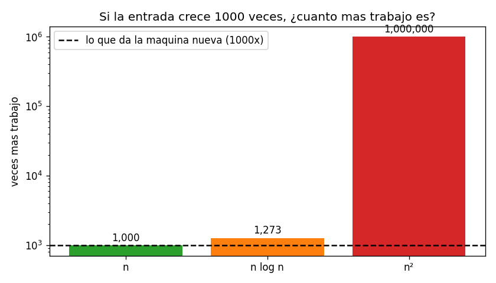
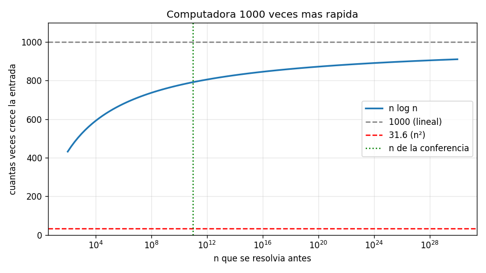

# Ejercicio 1

Una computadora mil veces más rápida. ¿Cuánto crece el tamaño de entrada que se resuelve en una hora con un algoritmo $\Theta(n^2)$? ¿Y con uno $\Theta(n \log n)$? Estima los dos factores.

## Idea

Si la computadora es 1000 veces más rápida, en una hora hace 1000 veces más operaciones. Si antes podía resolver entradas de tamaño $n$, ahora busco el $n'$ que cumple:

$$\text{costo}(n') = 1000 \cdot \text{costo}(n)$$

El ejercicio pide el factor $k = n'/n$, o sea, cuántas veces más grande es la entrada que ahora se puede resolver.

Las constantes de $\Theta$ no importan aquí porque aparecen en los dos lados de la igualdad y se cancelan.

Todos los casos de prueba están en `ejercicio-01-casos_prueba.py` y las gráficas se generan con `ejercicio-01-grafica.py`. Cada prueba tiene `assert`, así que si algo no cuadra el programa da error. La función `mayor_n` es la de la sección 7 de la conferencia: busca con búsqueda binaria el mayor $n$ que cabe en un presupuesto de operaciones.

---

## Parte 1: caso $\Theta(n^2)$

$$n'^2 = 1000 \cdot n^2 \implies n' = \sqrt{1000} \cdot n \approx 31.6 \cdot n$$

El factor es $k = \sqrt{1000} \approx 31.6$, y no depende de $n$. Aunque la máquina es 1000 veces más rápida, la entrada crece solo unas 32 veces, porque al duplicar la entrada el trabajo se multiplica por 4.

### Ejemplo con números chiquitos

- Antes: $n = 100$, o sea $100^2 = 10\,000$ operaciones.
- Ahora hay 1000 veces más operaciones: $10\,000\,000$.
- ¿Qué $n$ da $n^2 = 10\,000\,000$? Es $n \approx 3162$.
- $3162 / 100 \approx 31.6$ ✔️

### Casos de prueba

Prueba 1: el factor no depende del presupuesto. El resultado no depende del $n$ de partida: siempre sale 31.62.

```
 presupuesto        n antes        n despues   factor
        10^6          1,000           31,622    31.62
        10^9         31,622        1,000,000    31.62
       10^12      1,000,000       31,622,776    31.62
       10^15     31,622,776    1,000,000,000    31.62
```

Prueba 2: con un algoritmo de verdad. Para comprobar que las constantes no importan, se cuentan las comparaciones de selection sort, que son $\frac{n(n-1)}{2}$. Tiene una constante $\frac{1}{2}$ y un término $-n$ de más, pero el resultado no cambia:

```
n antes = 2,683,282  n despues = 84,852,814  factor = 31.6
```

Prueba 3: otras mejoras de velocidad. Si la máquina es $v$ veces más rápida, el factor es siempre $\sqrt{v}$:

```
 mas rapida   factor     sqrt
        10x      3.2      3.2
       100x     10.0     10.0
      1000x     31.6     31.6
   1000000x   1000.0   1000.0
```

Para que un algoritmo cuadrático resuelva entradas 1000 veces más grandes, hace falta una máquina un millón de veces más rápida.

---

## Parte 2: caso $\Theta(n \log n)$

Aquí no se puede despejar tan fácil. Sea $n' = k \cdot n$:

$$k n \log(kn) = 1000 \cdot n \log n$$

$$k (\log n + \log k) = 1000 \log n$$

$$k = 1000 \cdot \frac{\log n}{\log n + \log k}$$

De aquí sale algo importante: el factor es un poco menor que 1000, porque la fracción es menor que 1, y además depende de $n$. Mientras más grande es $n$, más pesa $\log n$ frente a $\log k$, y más se acerca $k$ a 1000.

Para tener un número concreto se usa la misma suposición que la conferencia: $10^9$ operaciones por segundo durante una hora, o sea $3.6 \cdot 10^{12}$ operaciones. Con eso se resuelve $n \approx 10^{11}$, y $\log_2 n \approx 36.5$.

Primer intento: $k = 1000$ en el lado derecho, donde $\log_2 1000 \approx 10$:

$$k \approx 1000 \cdot \frac{36.5}{36.5 + 10} \approx 785$$

Segundo intento: $k = 785$, con $\log_2 785 \approx 9.6$:

$$k \approx 1000 \cdot \frac{36.5}{36.5 + 9.6} \approx 792$$

Ya casi no cambia, así que **$k \approx 790$**.

### ¿Por qué no llega a 1000?

Si la entrada creciera 1000 veces, pasaría de $10^{11}$ a $10^{14}$, y el trabajo se multiplicaría por:

- la $n$: 1000 veces;
- el $\log n$: pasa de 36.5 a 46.5, o sea $\approx 1.27$ veces.

En total serían $\approx 1273$ veces más trabajo, y la máquina nueva solo da 1000. Se pasa, así que la entrada tiene que crecer un poco menos. La gráfica muestra también los otros dos casos para comparar: con $n$ alcanza justo, y con $n^2$ sería un millón de veces más trabajo.



### Demostración: el factor está entre dos cotas

Arriba se calculó $k \approx 790$ probando números. Ahora se demuestra algo que se cumpla siempre, para cualquier $n \ge 2$: que $k$ queda atrapado entre dos valores, una cota de abajo y una cota de arriba.

$$\underbrace{1000 \cdot \frac{\log n}{\log n + \log 1000}}_{\text{cota de abajo}} \;<\; k \;<\; \underbrace{1000}_{\text{cota de arriba}}$$

Todo sale de la ecuación de antes:

$$k (\log n + \log k) = 1000 \log n$$

#### Paso 0: $k$ es mayor que 1

Con una máquina más rápida se resuelven entradas más grandes, no más chicas, porque $n \log n$ es creciente. Entonces $k > 1$.

Esto me sirve porque, si $k > 1$, entonces $\log k > 0$. Lo voy a usar en los dos pasos siguientes.

#### Cota de arriba: $k < 1000$

La demostración es por contradicción: se supone lo contrario y se llega a algo imposible.

Supongamos que $k \ge 1000$, y miremos el lado izquierdo de la ecuación, $k(\log n + \log k)$.

1. Como $k$ es 1000 o más, multiplicar por $k$ da igual o más que multiplicar por 1000:
   $$k(\log n + \log k) \;\ge\; 1000(\log n + \log k)$$

2. Como $\log k > 0$ (paso 0), a $\log n$ le estoy sumando algo positivo, así que:
   $$1000(\log n + \log k) \;>\; 1000 \log n$$

3. Juntando los dos pasos:
   $$k(\log n + \log k) \;>\; 1000 \log n$$

Pero la ecuación dice que esos dos lados son iguales, y algo no puede ser a la vez igual y mayor. Contradicción. Entonces lo que supuse es falso, y $k < 1000$. ∎

#### Cota de abajo

Ahora se usa la fórmula despejada:

$$k = 1000 \cdot \frac{\log n}{\log n + \log k}$$

1. Acabo de demostrar que $k < 1000$, así que $\log k < \log 1000$.

2. Entonces el denominador de verdad es más chico que si se pusiera $\log 1000$:
   $$\log n + \log k \;<\; \log n + \log 1000$$

3. Si divido entre algo más chico, el resultado es más grande. Entonces:
   $$k = 1000 \cdot \frac{\log n}{\log n + \log k} \;>\; 1000 \cdot \frac{\log n}{\log n + \log 1000} \;∎$$

Esta cota tiene la ventaja de que el lado derecho ya no tiene $k$, así que se puede calcular directamente.

#### ¿Qué pasa cuando $n$ crece mucho?

Miro la fracción de la cota de abajo, $\frac{\log n}{\log n + 10}$:

| $\log_2 n$ | fracción                 | cota de abajo |
| ---------- | ------------------------ | ------------- |
| 10         | $10/20 = 0.50$           | 500           |
| 36.5       | $36.5/46.5 \approx 0.78$ | 785           |
| 100        | $100/110 \approx 0.91$   | 909           |
| 1000       | $1000/1010 \approx 0.99$ | 990           |

Mientras más grande es $\log n$, menos importa el "+10" y la fracción se acerca a 1. Así que la cota de abajo **sube hacia 1000**, y como $k$ está entre ella y 1000, $k$ también se acerca a 1000. Pero, por la cota de arriba, **nunca llega**.

#### Resumen de la demostración

- **Cota de arriba:** si $k$ fuera 1000 o más, haría falta más trabajo del que da la máquina, así que es imposible.
- **Cota de abajo:** como $k < 1000$, el denominador es más chico que con $\log 1000$, y eso obliga a que $k$ sea al menos 785.

### El factor según el $n$ de partida

A diferencia de $n^2$, aquí el factor sí depende de $n$. Resolviendo $k(\log n + \log k) = 1000 \log n$ para varios valores:

| $n$ inicial | factor $k$ |
| ----------- | ---------- |
| $10^3$      | 524        |
| $10^6$      | 679        |
| $10^9$      | 758        |
| $10^{11}$   | 791        |
| $10^{15}$   | 837        |

El factor siempre es menor que 1000 y se le va acercando a medida que $n$ crece, como predice la fórmula. En la gráfica se ve mejor:



- La curva azul es el factor de $n \log n$. Sube muy despacio hacia 1000 (línea gris), sin llegar nunca.
- La línea roja es el 31.6 de $n^2$, que no depende de $n$.
- La línea verde marca el $n$ de la conferencia, donde la curva vale unos 790.

### Casos de prueba

Prueba 4: búsqueda contra fórmula contra la cota de abajo. Comparo el factor real (con `mayor_n`), el que da la fórmula y la cota de abajo de la demostración:

```
 presupuesto          n antes  busqueda  formula  cota inf
        10^4            1,002     525.1    524.6     500.1
        10^6           62,746     631.4    631.4     615.3
        10^8        4,523,071     700.5    700.5     689.3
       10^10      352,213,444     748.3    748.3     740.2
       10^12   28,781,593,877     783.3    783.3     777.1
       10^14 2,430,466,173,822     809.8    809.8     805.0
       10^16 210,178,488,757,735     830.7    830.7     826.8
```

La fórmula coincide con la búsqueda, y el factor siempre queda entre la cota de abajo y 1000, como demostré.

Prueba 5: con un algoritmo de verdad. Se cuentan las comparaciones de merge sort en el peor caso, $C(n) = C(\lceil n/2 \rceil) + C(\lfloor n/2 \rfloor) + n - 1$:

```
n antes = 101,011,863,607  n despues = 79,590,159,326,709  factor = 787.9
```

Sale prácticamente lo mismo que con $n \log n$ "limpio".

Prueba 6: otras mejoras de velocidad. El factor siempre queda un poco por debajo de las veces:

```
 mas rapida     factor
        10x        9.2
       100x       85.1
      1000x      791.4
   1000000x   654026.4
```

---

## Comprobación

Se modificó el programa de la sección 7 de la conferencia para que calcule el $n$ máximo con 1 hora y con 1000 horas, que es lo mismo que una máquina 1000 veces más rápida:

```python
import math

def mayor_n(costo, presupuesto):
    alto = 2
    while costo(alto) <= presupuesto:
        alto *= 2
    bajo = alto // 2
    while bajo + 1 < alto:
        medio = (bajo + alto) // 2
        if costo(medio) <= presupuesto:
            bajo = medio
        else:
            alto = medio
    return bajo

hora = 3600 * 10**9
for nombre, costo in [("n^2", lambda n: n * n),
                      ("n log n", lambda n: n * math.log2(n))]:
    antes = mayor_n(costo, hora)
    despues = mayor_n(costo, 1000 * hora)
    print(nombre, antes, despues, despues / antes)
```

Salida:

```
n^2 1897366 60000000 31.62278653670404
n log n 98574774544 78008697597778 791.3657216934126
```

Coincide con lo calculado a mano: 31.6 y unos 790.
