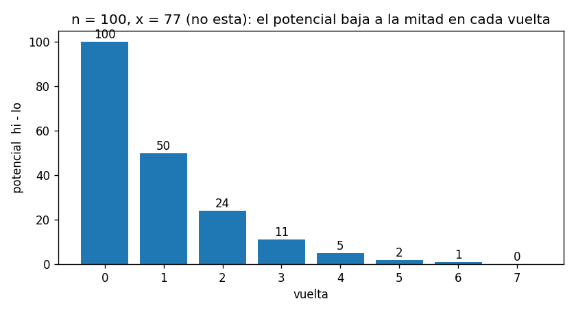
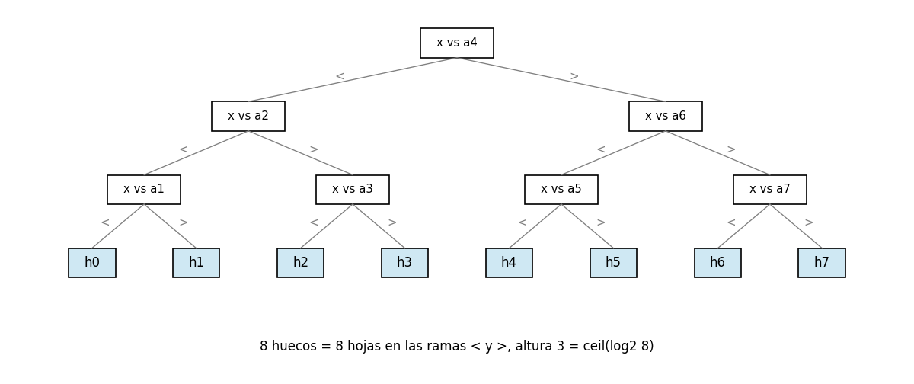
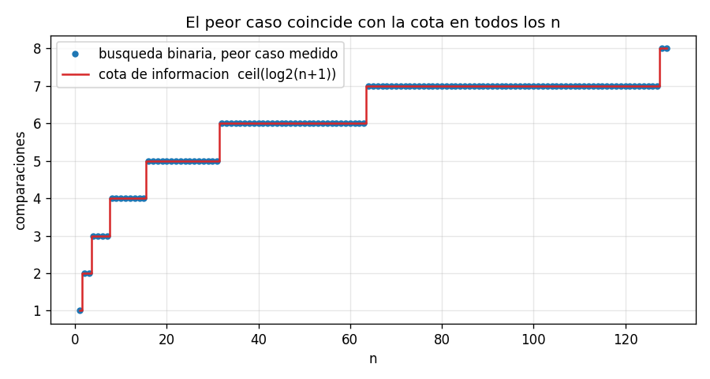

# Ejercicio 2

Da el invariante y el potencial de la búsqueda binaria, y la cota de información que la hace óptima.

## Idea

La búsqueda binaria busca un valor $x$ en un arreglo ordenado $a_1 < a_2 < \dots < a_n$. Mantiene un rango `A[lo:hi]` donde $x$ todavía puede estar, compara $x$ con el elemento del medio y descarta la mitad que no sirve.

El ejercicio pide tres cosas, y cada una responde una pregunta distinta (conferencia 3, sección 1, y conferencia 5):

- **El invariante:** por qué la respuesta es correcta.
- **El potencial:** por qué termina, y en cuántas vueltas.
- **La cota de información:** por qué ningún algoritmo de comparaciones puede hacerlo con menos preguntas.

Los casos de prueba están en `ejercicio-02-casos_prueba.py`, el algoritmo en `ejercicio-02-busqueda.py` y las gráficas se generan con `ejercicio-02-grafica.py`. Cada prueba tiene `assert`, así que si algo no cuadra el programa da error.

---

## Parte 1: el algoritmo

```python
def binary_search(A, x):
    lo, hi = 0, len(A)                 # invariante: si x está, está en A[lo:hi]
    while lo < hi:
        m = (lo + hi) // 2
        if x == A[m]:
            return ("found", m)
        if x < A[m]:
            hi = m
        else:
            lo = m + 1
    return ("gap", lo)
```

Cada vuelta compara $x$ con `A[m]`, y la respuesta es una de tres: igual, menor o mayor. Si es igual, $x$ está en la posición `m`. Si no, el rango se achica a la mitad de la izquierda (`hi = m`) o a la de la derecha (`lo = m + 1`).

Si $x$ no está, el algoritmo devuelve el hueco donde caería. Con $n$ elementos hay $n + 1$ huecos: $h_0$ antes de $a_1$, $h_1$ entre $a_1$ y $a_2$, y así hasta $h_n$ después de $a_n$. Devolver el hueco es más útil que decir solo "no está", porque dice dónde habría que insertar $x$.

### Ejemplo con una traza

Con `A = [3, 8, 15, 21, 30, 42, 57]` ($n = 7$):

```
x = 30:
  vuelta   lo   hi  hi - lo
       0    0    7        7
       1    4    7        3
       2    4    5        1
  resultado: ('found', 4)
x = 10:
  vuelta   lo   hi  hi - lo
       0    0    7        7
       1    0    3        3
       2    2    3        1
       3    2    2        0
  resultado: ('gap', 2)
```

Para $x = 10$, en la vuelta 0 se compara con 21 y se queda la mitad izquierda. En la vuelta 1 se compara con 8 y se queda la parte derecha de esa mitad. En la vuelta 2 se compara con 15 y el rango queda vacío: $x$ cae en el hueco $h_2$, entre 8 y 15.

### Casos de prueba

Prueba 1: las dos trazas de arriba, comprobadas con `assert`.

Prueba 2: casos borde.

```
  arreglo vacio                 OK
  un elemento, esta             OK
  un elemento, x menor          OK
  un elemento, x mayor          OK
  x es el primero               OK
  x es el ultimo                OK
  x menor que todos             OK
  x mayor que todos             OK
```

---

## Parte 2: el invariante

**Invariante:** antes de cada vuelta, si $x$ está en el arreglo, entonces está en `A[lo:hi]`. Además $0 \leq lo \leq hi \leq n$.

#### Inicialización

Al principio `lo = 0` y `hi = n`, así que `A[lo:hi]` es el arreglo entero. Si $x$ está en el arreglo, está ahí. ✔

#### Mantenimiento

Supongamos que el invariante se cumple antes de una vuelta, y que $x \neq$ `A[m]` (si es igual, el algoritmo termina). Hay dos casos:

1. **$x <$ `A[m]`:** como el arreglo está ordenado, todos los elementos de `A[m:hi]` son mayores o iguales que `A[m]`, y por lo tanto mayores que $x$. Así que $x$ no puede estar ahí. Si $x$ está, está en `A[lo:m]`, que es el rango nuevo (`hi = m`). ✔
2. **$x >$ `A[m]`:** por el mismo motivo, todo `A[lo:m+1]` es menor o igual que `A[m]`, y por lo tanto menor que $x$. Si $x$ está, está en `A[m+1:hi]`, que es el rango nuevo (`lo = m + 1`). ✔

En los dos casos `lo` y `hi` se mueven a un valor entre los que tenían, así que sigue valiendo $0 \leq lo \leq hi \leq n$.

#### Conclusión

El algoritmo termina de dos formas:

- **Devuelve `("found", m)`:** solo pasa cuando `A[m]` $= x$, así que la respuesta es correcta.
- **Devuelve `("gap", lo)`:** solo pasa cuando `lo = hi`, o sea, cuando `A[lo:hi]` está vacío. Por el invariante, si $x$ estuviera en el arreglo estaría en un rango vacío, lo cual es imposible. Así que $x$ no está. Además, todo lo que se descartó por la izquierda es menor que $x$ y todo lo que se descartó por la derecha es mayor, así que $x$ cae justo en el hueco `lo`. ✔

### Casos de prueba

Prueba 3: el invariante vigilado. Antes de cada vuelta se comprueba con `assert` que $0 \leq lo \leq hi \leq n$ y que, si $x$ está en el arreglo, está en `A[lo:hi]`. Son 3000 búsquedas al azar, con $x$ presente y ausente:

```
invariante comprobado en 14,866 vueltas, sin fallos
```

Prueba 4: contra un oráculo. Si el resultado es "found", se comprueba que `A[m]` $= x$. Si es "gap", se comprueba que $x$ no está, que todo lo que hay antes del hueco es menor y que todo lo que hay después es mayor:

```
5000 busquedas: 0 fallos
```

---

## Parte 3: el potencial

$$\Phi = hi - lo$$

Es el tamaño del rango donde $x$ todavía puede estar.

- **Nunca es negativo:** por el invariante, $lo \leq hi$.
- **Baja en cada vuelta, y mucho:** si el rango tiene tamaño $k = hi - lo$ y el medio es `m = (lo + hi) // 2`, la mitad izquierda tiene $\lfloor k/2 \rfloor$ elementos y la derecha $\lceil k/2 \rceil - 1$. Las dos son a lo sumo $\lfloor k/2 \rfloor$. Así que en cada vuelta el potencial queda en a lo sumo la mitad de lo que era.
- **Cuando llega a 0, el ciclo termina:** la condición del `while` es justo $\Phi > 0$.

Como el potencial empieza en $n$ y en cada vuelta se divide al menos por 2, después de $t$ vueltas es a lo sumo $n / 2^t$. Cuando $2^t > n$ ya vale 0. El algoritmo termina después de a lo sumo $\lfloor \log_2 n \rfloor + 1$ vueltas, que es igual a $\lceil \log_2 (n+1) \rceil$.



Con $n = 100$ y un $x$ que no está: 100, 50, 24, 11, 5, 2, 1, 0. Son 7 vueltas con comparación, y $\lceil \log_2 101 \rceil = 7$.

### El `+ 1` importa

El potencial explica por qué es `lo = m + 1` y no `lo = m`. Con `lo = m`, si el rango tiene tamaño 1, el medio es `m = lo`, y si $x >$ `A[m]` el rango no cambia: `lo` sigue igual y el potencial no baja. El ciclo se repite para siempre. Es justo el ejercicio 7 de la conferencia 3.

El invariante, en cambio, se sigue cumpliendo con `lo = m`, porque `A[m]` $< x$ y quedarse con `A[m:hi]` no pierde a $x$. Por eso el error no lo atrapa el invariante: lo atrapa el potencial. Y solo se cuelga cuando $x$ no está, porque si $x$ está, al llegar a un rango de tamaño 1 ese elemento es $x$ y la búsqueda lo encuentra.

### Casos de prueba

Prueba 5: en 3000 búsquedas al azar se comprueba con `assert` que, de una vuelta a la siguiente, el potencial queda en a lo sumo la mitad:

```
en 3000 busquedas el potencial siempre baja al menos a la mitad
```

Prueba 7: la versión con `lo = m`, cortada después de 1000 vueltas:

```
                     x  busquedas  no terminan
  x esta en el arreglo       3000            0
             x no esta       3000         2755
contraejemplo mas chico: A = [1], x = 2 -> None
```

Si las pruebas solo buscan valores que están en el arreglo, la versión con el error pasa todas. Se cuelga en el 92% de las búsquedas de valores que no están. El contraejemplo más chico es buscar 2 en `[1]`: el rango es `[0, 1)`, el medio es 0, $2 > 1$, así que `lo = 0`, y el rango no cambia nunca.

---

## Parte 4: la cota de información

Ahora la pregunta es sobre cualquier algoritmo: ¿puede alguno buscar con menos comparaciones? En el modelo de comparaciones (conferencia 5, sección 1), el algoritmo solo puede comparar $x$ con elementos del arreglo, y su costo es la cantidad de comparaciones.

### Los huecos necesitan hojas distintas

Un algoritmo de comparaciones es un árbol de decisión: cada nodo es una comparación y cada hoja es una respuesta. El peor caso es la altura del árbol (conferencia 5, sección 2).

Cada comparación tiene tres respuestas posibles ($<$, $=$, $>$), pero cuando $x$ no está en el arreglo nunca sale "$=$". Entonces, para los valores de $x$ que caen en huecos, el árbol se comporta como un árbol binario. Lo que hay que ver es que cada hueco necesita su propia hoja.

**Lema.** Si $x_1$ y $x_2$ caen en huecos distintos, un algoritmo correcto los lleva a hojas distintas.

**Demostración.** Supongamos que $x_1$ está en un hueco a la izquierda del de $x_2$, y que los dos llegan a la misma hoja.

1. Entre los dos huecos hay al menos un elemento $a_i$, con $x_1 < a_i < x_2$.
2. El algoritmo nunca comparó con ese $a_i$: si lo hubiera hecho, $x_1$ habría recibido "$<$" y $x_2$ habría recibido "$>$", y habrían seguido caminos distintos.
3. Sea $x = a_i$. En cada comparación que hace el algoritmo (con elementos a la izquierda de los dos huecos o a la derecha), $x = a_i$ recibe la misma respuesta que $x_1$ y $x_2$. Así que llega a la misma hoja.
4. En esa hoja el algoritmo responde "no está", porque es la hoja de $x_1$. Pero $a_i$ sí está. El algoritmo se equivoca. ∎

### La cota

Hay $n + 1$ huecos, así que el árbol tiene al menos $n + 1$ hojas que se alcanzan solo con respuestas $<$ y $>$. Un árbol binario de altura $h$ tiene a lo sumo $2^h$ hojas (conferencia 5, lema 1). Entonces

$$2^h \geq n + 1 \quad\Rightarrow\quad h \geq \log_2 (n+1)$$

y como $h$ es un entero, $h \geq \lceil \log_2 (n+1) \rceil$.

Por lo tanto, todo algoritmo de comparaciones hace al menos $\lceil \log_2 (n+1) \rceil$ comparaciones en el peor caso.

### La búsqueda binaria es óptima

Por el potencial, la búsqueda binaria hace a lo sumo $\lfloor \log_2 n \rfloor + 1 = \lceil \log_2 (n+1) \rceil$ comparaciones. Es exactamente la cota, así que ningún algoritmo de comparaciones puede hacerlo mejor, ni siquiera por una comparación.

Así se ve el árbol de la búsqueda binaria con $n = 7$, obtenido corriéndola con un valor de cada hueco:



Tiene 8 hojas, una por hueco, y altura 3. Es un árbol binario completo: no se puede meter 8 hojas en un árbol de altura 2.

### Casos de prueba

Prueba 6: el peor caso exacto, probando todos los elementos y todos los huecos, contra la cota:

```
     n  peor caso  ceil(log2(n+1))  busqueda lineal
     1          1                1                1
     2          2                2                2
     3          2                2                3
     7          3                3                7
     8          4                4                8
   100          7                7              100
  1000         10               10             1000
  1023         10               10             1023
  1024         11               11             1024
```

En todos los casos el peor caso es exactamente la cota. Entre $n = 1023$ y $n = 1024$ la cota sube de 10 a 11, porque con 1024 elementos hay 1025 huecos, y 1025 hojas no caben en un árbol de altura 10 ($2^{10} = 1024$).



Para todos los $n$ de 1 a 129, los puntos del peor caso medido caen sobre la escalera de la cota.
