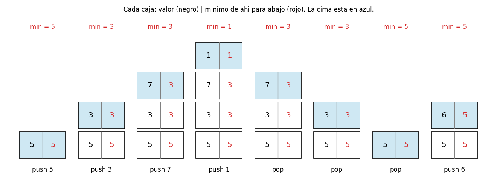
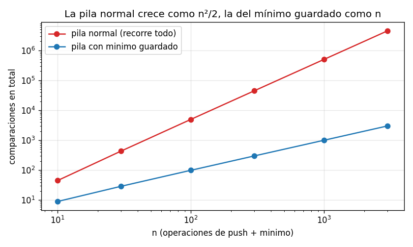
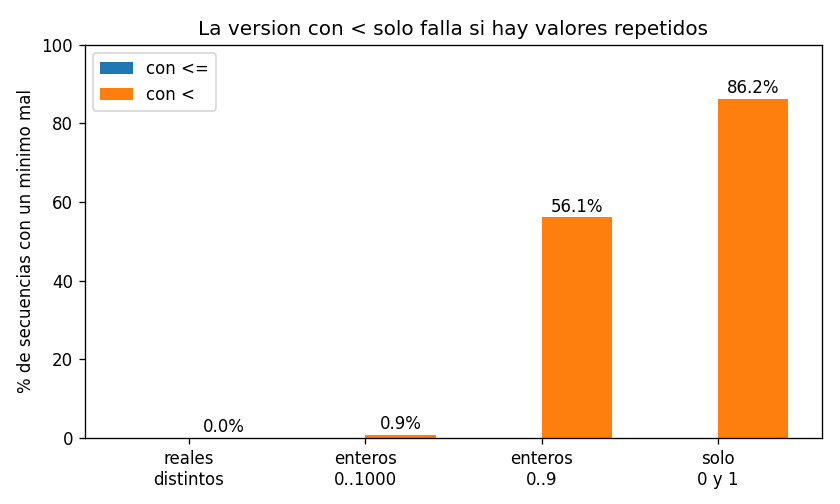

# Ejercicio 3

Una pila con una operación minimo que cuesta $O(1)$ en el peor caso. Diseña la estructura, enuncia el invariante que la hace correcta y da el costo de cada operación.

## Idea

Una pila tiene tres operaciones básicas, `push`, `pop` y `top`, y las tres cuestan $O(1)$. Lo difícil es la cuarta operación que pide el ejercicio, `minimo()`: si hay que recorrer toda la pila para buscarlo, cuesta $O(n)$.

La primera idea que sale es guardar una sola variable min y actualizarla en cada `push`. Eso funciona mientras solo se hace `push`, pero se rompe con `pop`:

| operación | pila   | variable min | mínimo real |
| --------- | ------ | ------------ | ----------- |
| push 3    | [3]    | 3            | 3           |
| push 1    | [3, 1] | 1            | 1           |
| pop       | [3]    | **1**        | 3           |

Cuando sale el 1, la variable no sabe cuál era el mínimo de antes. Para recuperarlo habría que recorrer la pila, y se vuelve a $O(n)$.

La solución es que cada elemento recuerde cuál era el mínimo cuando entró. Así, después de un `pop`, el mínimo anterior está guardado en el elemento que queda en la cima.

Los casos de prueba están en `ejercicio-03-casos_prueba.py`, la estructura en `ejercicio-03-pila.py` y las gráficas se generan con `ejercicio-03-grafica.py`. Cada prueba tiene `assert`, así que si algo no cuadra el programa da error.

---

## Parte 1: la estructura

Cada nodo de la pila guarda tres cosas:

- `value`: el elemento;
- `min`: el menor entre este elemento y **todos los que tiene debajo**;
- `below`: el nodo de abajo, para poder bajar por la pila.

La pila solo necesita saber cuál es el nodo de arriba (`top_node`). Desde ahí se llega a todos los demás bajando por `below`. Por ejemplo, después de `push` de 5, 3 y 7:

```
top_node → [value 7 | min 3]
                  ↓ below
           [value 3 | min 3]
                  ↓ below
           [value 5 | min 5]
                  ↓ below
                 None
```

Las operaciones son:

- **push(x):** si la pila está vacía, el nuevo nodo guarda `min = x`. Si no, guarda `min = min(x, min de la cima)`. El nodo nuevo apunta a la cima vieja y pasa a ser la cima.
- **pop():** la cima pasa a ser el nodo de abajo, y se devuelve el valor que tenía.
- **top():** devuelve el valor de la cima.
- **minimo():** devuelve el `min` guardado en la cima.

```python
class Node:
    def __init__(self, value, min, below):
        self.value = value
        self.min = min
        self.below = below


class MinStack:
    def __init__(self):
        self.top_node = None

    def push(self, x):
        if self.top_node is None:
            new_min = x
        else:
            new_min = x if x < self.top_node.min else self.top_node.min
        self.top_node = Node(x, new_min, self.top_node)

    def pop(self):
        x = self.top_node.value
        self.top_node = self.top_node.below
        return x

    def top(self):
        return self.top_node.value

    def minimo(self):
        return self.top_node.min
```

Es una versión resumida. La de `ejercicio-03-pila.py` además cuenta las comparaciones, y da error si se llama a `pop`, `top` o `minimo` con la pila vacía.

La pila está hecha con nodos enlazados (cada nodo apunta al de abajo) y no con una lista de Python. El `append` de una lista es $O(1)$ amortizado, no en el peor caso: a veces la lista se llena y hay que copiarla entera (conferencia 4). Con nodos enlazados, un `push` es siempre crear un nodo y mover un puntero.

### Ejemplo con una traza

Secuencia de ejemplo: `push` de 5, 3, 7 y 1, después tres `pop` y un `push` de 6.



### Casos de prueba

Prueba 1: la secuencia de la traza, comprobando el mínimo después de cada operación.

```
   operacion   pila (abajo -> arriba)  minimo
      push 5                      [5]       5
      push 3                   [5, 3]       3
      push 7                [5, 3, 7]       3
      push 1             [5, 3, 7, 1]       1
         pop                [5, 3, 7]       3
         pop                   [5, 3]       3
         pop                      [5]       5
      push 6                   [5, 6]       5
```

Prueba 2: casos borde.

```
  pila vacia: pop, top y minimo dan error                   OK
  repetidos [2, 2, 2]: el minimo sigue siendo 2             OK
  decreciente 10..1: con cada pop el minimo vuelve a subir  OK
  creciente 1..10: el minimo siempre es 1                   OK
  negativos [-3, 0, -7, 4]: minimo -7, top 4                OK
  palabras: minimo 'kiwi' (orden alfabetico)                OK
```

El de la pila vacía es importante: `pop`, `top` y `minimo` solo tienen sentido si hay algo en la pila. Esa es la **precondición** de esas operaciones, y si no se cumple la estructura da error en vez de devolver un valor sin sentido. El de palabras muestra que sirve para cualquier cosa que se pueda comparar con `<`, no solo para números.

---

## Parte 2: el invariante

**Invariante:** en todo momento, para cada nodo de la pila,

$$\text{min del nodo} = \min(\text{su valor y todos los valores que tiene debajo})$$

Antes de la demostración, una observación en la que se basa la demostración: lo que hay debajo de un nodo nunca cambia mientras el nodo está en la pila. Una pila solo toca la cima. Si un nodo está en la pila, los de abajo entraron antes que él y no pueden salir hasta que él salga. Por eso el mínimo que un nodo guarda al entrar sigue siendo correcto todo el tiempo que esté ahí.

La demostración sigue los tres pasos de la conferencia 3.

#### Inicialización

Al principio la pila está vacía. No hay nodos, así que no hay nada que pueda fallar: el invariante se cumple.

#### Mantenimiento

Se supone que el invariante se cumple antes de una operación, y hay que ver que se sigue cumpliendo después. Hay un caso por operación:

1. **push(x) con la pila vacía.** El nodo nuevo guarda `min = x`. No tiene nada debajo, así que el mínimo de "él y los de abajo" es $x$.

2. **push(x) con la pila no vacía.** El nodo nuevo guarda $\min(x, \text{min de la cima})$. Por el invariante, el `min` de la cima es el mínimo de la cima y todo lo que tiene debajo, o sea, de toda la pila. Entonces el nodo nuevo guarda $\min(x, \text{toda la pila de abajo})$, que es justo lo que pide el invariante.
   Los nodos viejos no se tocan, y lo que tienen debajo tampoco cambió, así que siguen cumpliendo.

3. **pop().** Se quita la cima. Los demás nodos no cambian, y lo que tienen debajo tampoco (por la observación de arriba). Siguen cumpliendo.

4. **top() y minimo().** No modifican nada, así que el invariante sigue igual.

#### Conclusión

`minimo()` devuelve el `min` de la cima. Por el invariante aplicado a la cima, ese número es el mínimo de la cima y todo lo que tiene debajo, o sea, el mínimo de toda la pila. Así que `minimo()` siempre devuelve la respuesta correcta. ∎

#### Terminación

Ninguna operación tiene ciclos: cada una hace una cantidad fija de pasos y termina. Según la conferencia 3, la correctitud total es la correctitud parcial (lo de arriba) más la terminación, así que la estructura es totalmente correcta.

### Casos de prueba

Prueba 3: el invariante vigilado. Como en la sección 4 de la conferencia 3, después de cada operación se revisan todos los nodos y se comprueba con `assert` que el mínimo guardado es el menor de ese nodo y los de abajo. Son 2000 secuencias al azar de hasta 40 operaciones:

```
invariante comprobado en 148,711 nodos, sin fallos
```

Esto no reemplaza la demostración (revisa muchos casos, pero no todos), pero si el invariante estuviera mal escrito, el `assert` lo habría detectado.

Prueba 4: contra un oráculo. Las respuestas de `minimo()` se comparan con la forma directa: guardar una lista y calcular `min()` cada vez. Se prueba con varios tipos de valores, sobre todo con valores **repetidos**, que es donde suelen estar los errores (ver la parte 4):

```
           valores  secuencias  fallos
  reales distintos        3000       0
   enteros 0..1000        3000       0
      enteros 0..9        3000       0
        solo 0 y 1        3000       0
```

---

## Parte 3: el costo de cada operación

| operación  | qué hace                                 | comparaciones | costo en el peor caso |
| ---------- | ---------------------------------------- | ------------- | --------------------- |
| `push(x)`  | compara $x$ con un número y crea un nodo | a lo sumo 1   | $O(1)$                |
| `pop()`    | mueve el puntero de la cima              | 0             | $O(1)$                |
| `top()`    | lee la cima                              | 0             | $O(1)$                |
| `minimo()` | lee el mínimo guardado en la cima        | 0             | $O(1)$                |

Todas son $O(1)$ en el peor caso, no en promedio ni amortizado: ninguna tiene ciclos y ninguna depende de cuántos elementos haya en la pila.

**Memoria:** cada nodo guarda un número extra (su `min`), así que con $n$ elementos se usan $n$ números de más. La memoria es $O(n)$, igual que una pila normal, solo que con el doble de datos.

**¿Se puede hacer mejor?** En tiempo no: ninguna operación puede costar menos que $O(1)$. En memoria sí se puede ahorrar en muchos casos, y eso es la parte 4.

### Casos de prueba

Prueba 5: conteo de comparaciones. Se hace `push` de $n$ números de mayor a menor (así el mínimo cambia en cada paso, que es el peor caso para `push`) y después se pide el mínimo. Se compara con una pila normal, que recorre todo para buscar el mínimo:

```
      n     push   minimo   minimo normal
     10        1        0               9
    100        1        0              99
  1,000        1        0             999
 10,000        1        0           9,999
```

La pila con mínimo guardado hace siempre a lo sumo 1 comparación en cada `push` y 0 al pedir el mínimo, tenga 10 o 10 000 elementos. La pila normal hace $n - 1$.

Si en vez de pedir el mínimo una sola vez se pide después de cada `push`, la diferencia se nota mucho más. La pila normal hace $0 + 1 + 2 + \dots + (n-1) = \frac{n(n-1)}{2}$ comparaciones en total, y la otra solo $n - 1$:



(Escala logarítmica en los dos ejes. Con 3000 operaciones, la pila normal hace unos 4.5 millones de comparaciones y la otra 2999.)

---

## Parte 4: una versión que ahorra memoria, y un error fácil

En la parte 1 cada nodo guarda su mínimo, aunque casi siempre sea el mismo que el del nodo de abajo. Una versión más ahorrativa usa dos pilas:

- `data`: la pila normal;
- `mins`: solo guarda un elemento cuando entra uno que es menor o igual que el mínimo actual.

```python
def push(self, x):
    self.data.append(x)
    if not self.mins or x <= self.mins[-1]:
        self.mins.append(x)

def pop(self):
    x = self.data.pop()
    if x == self.mins[-1]:
        self.mins.pop()
    return x

def minimo(self):
    return self.mins[-1]
```

Por ejemplo, con `push` de 1, 2, 3, ..., 1000, la pila `mins` solo tiene el 1: se ahorra casi toda la memoria. En el peor caso (números de mayor a menor) se guardan todos, así que sigue siendo $O(n)$, pero muchas veces es bastante menos.

### ¿Por qué tiene que ser `<=` y no `<`?

Una simplificación posible es escribir `x < self.mins[-1]` ("solo se guarda si es un mínimo nuevo"). Parece lo mismo, pero está mal. El contraejemplo más chico:

| operación | `data` | `mins` con `<`     | `mins` con `<=` |
| --------- | ------ | ------------------ | --------------- |
| push 1    | [1]    | [1]                | [1]             |
| push 1    | [1, 1] | [1] (no se guarda) | [1, 1]          |
| pop       | [1]    | **[]**             | [1]             |

Con `<`, el segundo 1 no se guarda en `mins`. Pero al sacarlo con `pop`, como es igual al mínimo, sí se quita uno de `mins`, y se quita el del primer 1, que sigue en la pila. Ahora la pila tiene un 1 y `mins` está vacía: `minimo()` da error.

El invariante dice dónde está el error. Para que `pop` sea correcto hace falta esto: si el elemento de la cima es igual al mínimo, entonces está guardado en `mins`. Con `<=` se cumple: cuando ese elemento entró, era menor o igual que todos los de abajo, así que se guardó. Con `<` solo se cumple si no hay otro elemento igual debajo. O sea, el error solo puede aparecer con valores repetidos iguales al mínimo. Esto se deduce del argumento, y las pruebas lo confirman.

### Casos de prueba

Prueba 6: las dos versiones contra el oráculo, con los mismos generadores de la prueba 4:

```
           valores   con <=    con <
  reales distintos     0.0%     0.0%
   enteros 0..1000     0.0%     0.9%
      enteros 0..9     0.0%    56.1%
        solo 0 y 1     0.0%    86.2%
```



La fila más importante de la tabla es la primera. Con números reales al azar (`random.random()`), que es el generador de pruebas más habitual, nunca salen dos iguales, y la versión con `<` pasa el 100% de las pruebas aunque está mal. Con enteros de 0 a 1000 casi no se ve (0.9%). Solo con pocos valores distintos, donde se repiten mucho, el error aparece con frecuencia.

Es la misma lección que la sección 5 de la conferencia 3 con el atajo del contador: las pruebas más habituales no lo encuentran, y lo que dice qué hay que probar es la demostración.

Prueba 7: el contraejemplo de la tabla, ejecutado.

```
push 1, push 1, pop -> minimo() revienta, y en la pila queda un 1
con <= da 1, que es lo correcto
```
