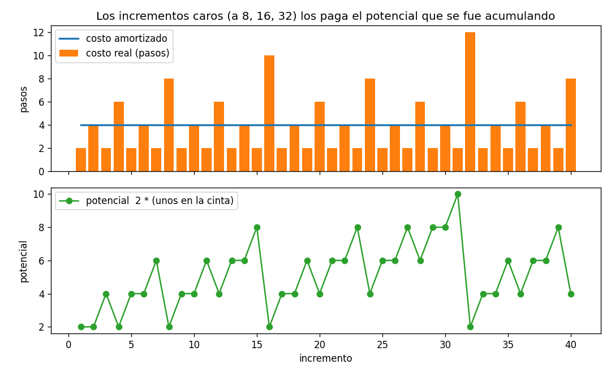
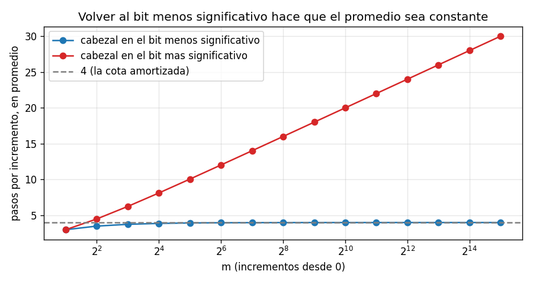

# Ejercicio 4

El contador binario en una máquina de Turing, del ejercicio 7 de la conferencia 1. Demuestra con un potencial que $m$ incrementos desde 0 cuestan $O(m)$ pasos en total, aunque uno solo pueda costar $\Theta(\log m)$. Es la pregunta que la conferencia 1 dejó abierta.

## Idea

El ejercicio 7 de la conferencia 1 pedía una máquina de Turing de una cinta que sume 1 a un número escrito en binario, con el cabezal empezando en el bit menos significativo y volviendo a él al terminar.

Sumar 1 en binario funciona así: los 1 del final se vuelven 0 (es el acarreo), y el primer 0 que aparece se vuelve 1. Por ejemplo, $1011 + 1 = 1100$: los dos 1 del final pasan a 0 y el 0 de antes pasa a 1.

Un incremento es caro cuando el número termina en muchos 1. El peor caso es pasar de $2^k - 1$ (todos 1) a $2^k$, donde hay que tocar los $k$ bits. Pero eso pasa muy pocas veces: la mitad de los números terminan en 0 y el incremento cuesta poco. La pregunta es cuánto cuestan $m$ incrementos seguidos, y la herramienta es el método del potencial de la conferencia 4.

Los casos de prueba están en `ejercicio-04-casos_prueba.py`, la máquina en `ejercicio-04-turing.py` y las gráficas se generan con `ejercicio-04-grafica.py`. Cada prueba tiene `assert`, así que si algo no cuadra el programa da error.

---

## Parte 1: la máquina

El número está escrito en binario, con el bit más significativo a la izquierda. El cabezal empieza en el bit menos significativo (el de la derecha). Una celda en blanco (`_`) cuenta como 0, así que la cinta vacía representa el 0.

La máquina tiene dos estados de trabajo, más el estado final `halt`:

| estado | lee | escribe | se mueve | estado nuevo | qué hace |
| --- | --- | --- | --- | --- | --- |
| `carry` | `1` | `0` | izquierda | `carry` | $1 + 1 = 0$ y el acarreo sigue |
| `carry` | `0` | `1` | derecha | `back` | $0 + 1 = 1$, se acaba el acarreo |
| `carry` | `_` | `1` | derecha | `back` | el número crece un bit |
| `back` | `0` | `0` | derecha | `back` | volver hacia la derecha... |
| `back` | `1` | `1` | derecha | `back` | |
| `back` | `_` | `_` | izquierda | `halt` | ...pasarse del último bit y retroceder uno |

En `carry` la máquina va hacia la izquierda convirtiendo los 1 en 0, hasta encontrar un 0 o un blanco, que convierte en 1. En `back` vuelve hacia la derecha hasta pasarse del número, y retrocede un paso para quedar en el bit menos significativo.

### Ejemplo con la cinta

```
 incremento  valor  pasos   cinta (el cabezal entre corchetes)
          1      1      2   [1] _ 
          2      2      4    1 [0] _ 
          3      3      2    1 [1] _ 
          4      4      6    1  0 [0] _ 
          5      5      2    1  0 [1] _ 
          6      6      4    1  1 [0] _ 
          7      7      2    1  1 [1] _ 
          8      8      8    1  0  0 [0] _ 
```

El incremento 8 (de $111$ a $1000$) es el más caro: 3 pasos convirtiendo los 1 en 0, 1 paso escribiendo el 1 nuevo, 3 pasos volviendo a la derecha sobre los 0, y 1 paso para retroceder desde el blanco. En total, 8.

### El costo de un incremento

Si el número antes de sumar termina en $t$ unos, la máquina da:

- $t$ pasos en `carry` sobre los 1;
- 1 paso en `carry` escribiendo el 1;
- $t$ pasos en `back` sobre los 0 que quedaron;
- 1 paso en `back` leyendo el blanco y retrocediendo.

En total, $c = 2t + 2$ pasos.

### Casos de prueba

Prueba 1: la tabla de arriba.

Prueba 2: contra un oráculo. Después de cada uno de 5000 incrementos se comprueba con `assert` que la cinta tiene el número correcto y que el cabezal está en el bit menos significativo:

```
5000 incrementos: siempre el valor correcto y el cabezal en el bit menos significativo
```

Prueba 3: el costo de cada incremento contra la fórmula $2t + 2$:

```
5000 incrementos: el costo coincide siempre con 2t + 2
```

---

## Parte 2: un solo incremento puede costar $\Theta(\log m)$

Al pasar de $2^k - 1$ a $2^k$, el número antes de sumar es $\underbrace{11\ldots1}_{k}$, así que $t = k$ y el incremento cuesta $2k + 2$ pasos. Si se hacen $m = 2^k$ incrementos desde 0, el último cuesta $2 \log_2 m + 2$ pasos, que es $\Theta(\log m)$.

Analizando operación por operación, la cota sería: cada incremento cuesta a lo sumo $2 \log_2 m + 2$, así que $m$ incrementos cuestan $O(m \log m)$. Es verdadero, pero no es ajustado, igual que el arreglo dinámico de la sección 1 de la conferencia 4.

### Casos de prueba

Prueba 6: los incrementos de $2^j - 1$ a $2^j$:

```
      de        a  pasos  2 * bits + 2
       1        2      4             4
      15       16     10            10
     255      256     18            18
   4,095    4,096     26            26
  65,535   65,536     34            34
```

---

## Parte 3: el potencial

Hay que encontrar la "deuda" que deja pendiente la estructura (conferencia 4, sección 3). Un incremento caro es uno que encuentra muchos 1 al final. Así que la deuda son los 1 de la cinta: cada 1 es un bit que algún incremento futuro va a tener que convertir en 0, y además va a tener que volver a pasar por encima.

$$\Phi = 2 \cdot (\text{cantidad de unos en la cinta})$$

### Las tres condiciones de un buen potencial

- **Empieza en 0:** la cinta vacía no tiene unos.
- **Nunca es negativo:** es una cantidad de unos.
- **Sube cuando se acumula deuda y baja cuando se paga.**

### El costo amortizado de un incremento

Si el número termina en $t$ unos antes de sumar:

- el costo real es $c = 2t + 2$;
- los $t$ unos del final pasan a 0, y aparece un 1 nuevo, así que la cantidad de unos cambia en $1 - t$, y el potencial cambia en $\Delta\Phi = 2(1 - t) = 2 - 2t$.

El costo amortizado es

$$\hat{c} = c + \Delta\Phi = (2t + 2) + (2 - 2t) = 4$$

Es exactamente 4 en todos los incrementos, sin importar $t$. Los $2t$ pasos del acarreo los pagan los $t$ unos que desaparecen, cada uno con las 2 unidades que dejó guardadas cuando se escribió.

### La suma

Por la conferencia 4 (sección 2), los términos del potencial se cancelan al sumar:

$$\sum_{k=1}^{m} c_k = \sum_{k=1}^{m} \hat{c}_k - \Phi_m + \Phi_0 = 4m - \Phi_m + 0 \leq 4m$$

La desigualdad usa que $\Phi_m \geq 0$ y $\Phi_0 = 0$, que es justo la condición que la conferencia 4 dice que no hay que olvidar. Entonces $m$ incrementos desde 0 cuestan a lo sumo $4m$ pasos: $O(m)$. ∎

Además, como $\Phi_m = 2 \cdot (\text{unos de } m)$, la cuenta da el total exacto:

$$\sum_{k=1}^{m} c_k = 4m - 2 \cdot (\text{cantidad de unos de } m \text{ en binario})$$



Las barras naranjas son el costo real de cada incremento: la mayoría cuesta 2, y cada tanto hay uno caro. La línea azul es el costo amortizado, que vale siempre 4. Abajo, el potencial sube despacio con los incrementos baratos y cae de golpe en los caros (en 8, 16 y 32), justo lo que esos incrementos cuestan de más.

### Comprobación con el método agregado

El mismo resultado sale contando de otra forma (conferencia 4, sección 2). El bit $i$ (contando desde 0 a la derecha) cambia de 1 a 0 una vez cada $2^{i+1}$ incrementos, así que en $m$ incrementos se apaga a lo sumo $m / 2^{i+1}$ veces. El total de bits que se apagan es a lo sumo

$$\frac{m}{2} + \frac{m}{4} + \frac{m}{8} + \dots < m$$

Cada bit que se apaga cuesta 2 pasos (ir y volver), y cada incremento tiene además 2 pasos fijos. En total, menos de $2m + 2m = 4m$.

### Casos de prueba

Prueba 4: el costo amortizado de cada incremento, calculado con el potencial antes y después:

```
costos amortizados que aparecen en 5000 incrementos: {4}
```

Prueba 5: el costo total contra la fórmula exacta y contra la cota $4m$:

```
       m     total  4m - 2*unos(m)  total / m  el mas caro  2*log2(m)+2
      10        36              36      3.600            8          8.6
     100       394             394      3.940           14         15.3
   1,000     3,988           3,988      3.988           20         21.9
   1,024     4,094           4,094      3.998           22         22.0
  10,000    39,990          39,990      3.999           28         28.6
  65,535   262,108         262,108      4.000           32         34.0
  65,536   262,142         262,142      4.000           34         34.0
```

El total coincide siempre con la fórmula y nunca pasa de $4m$. El incremento más caro sí crece como $2 \log_2 m + 2$, pero el promedio se queda en 4.

---

## Parte 4: por qué importa volver al bit menos significativo

El enunciado pide que el cabezal empiece y termine en el bit menos significativo. Eso no es un detalle: es lo que hace que el costo sea $O(m)$.

Si el cabezal empezara y terminara en el bit más significativo, cada incremento tendría que caminar hasta el final del número y volver, aunque no haya acarreo. Eso son al menos $2 \cdot (\text{cantidad de bits})$ pasos por incremento, siempre. Con números de $\log_2 m$ bits, el total sería $\Theta(m \log m)$, y no hay potencial que lo arregle, porque el trabajo ya no es una deuda que se paga una vez: se repite en cada incremento.

En la máquina de la parte 1, en cambio, el trabajo de cada incremento depende solo de los unos del final, que son los que el potencial paga.

### Casos de prueba

Prueba 7: el costo promedio por incremento en las dos versiones:

```
      m  total / m (LSB)  total / m (MSB)  log2(m)
     16             3.88             8.12      4.0
    256             3.99            16.01      8.0
  4,096             4.00            24.00     12.0
 32,768             4.00            30.00     15.0
```



Con el cabezal en el bit menos significativo, el promedio se queda en 4. Con el cabezal en el más significativo, crece como $2 \log_2 m$, una recta en el eje logarítmico.
