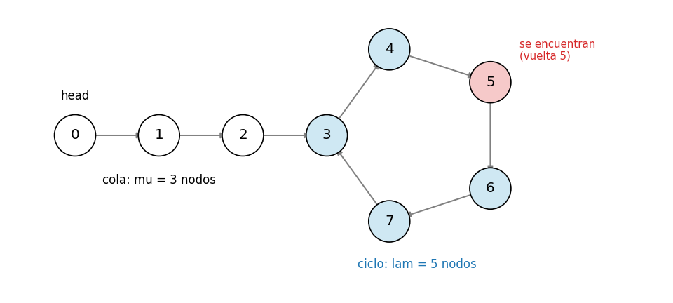
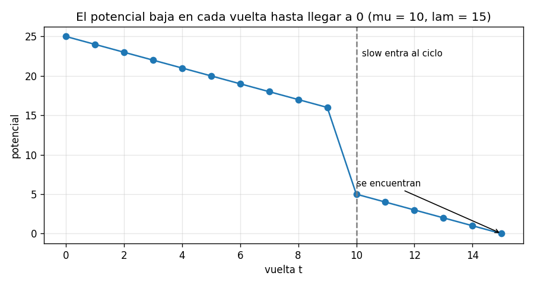
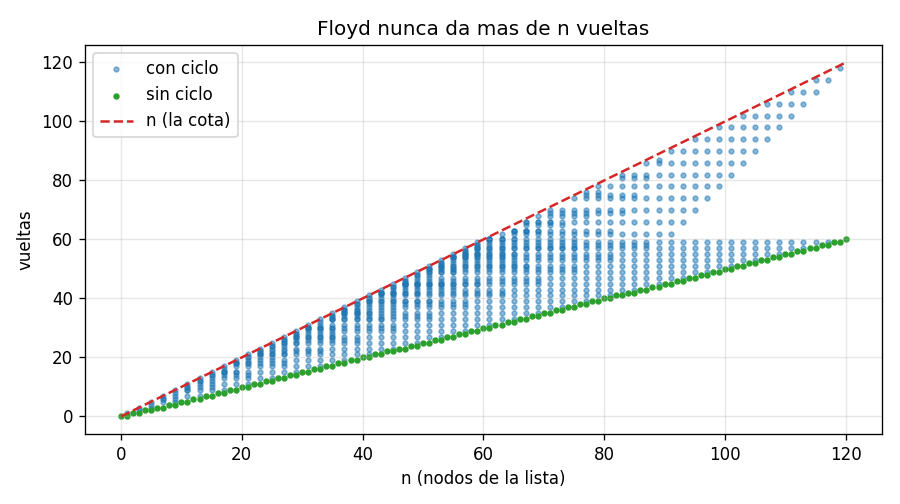
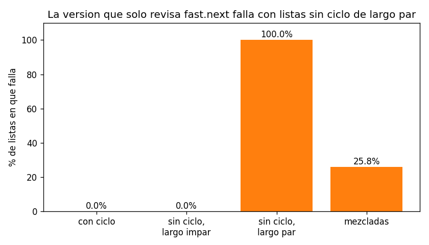

# Ejercicio 5

Detección de ciclos en una lista enlazada con dos punteros que avanzan a velocidades 1 y 2 (algoritmo de Floyd). Demuestra que se encuentran si y solo si hay un ciclo, con un invariante, y que termina, con un potencial. Da el costo.

## Idea

En una lista enlazada cada nodo apunta al siguiente. Hay dos posibilidades:

- **sin ciclo:** se avanza y en algún momento se llega a `None`;
- **con ciclo:** el último nodo apunta a uno anterior, y la lista no se termina nunca.

Con ciclo, la lista tiene forma de "rho" (ρ): una **cola** de $\mu$ nodos y después un **ciclo** de $\lambda$ nodos. En total $n = \mu + \lambda$ nodos. Por ejemplo, con $\mu = 3$ y $\lambda = 5$:



Lo difícil es que, recorriendo la lista con un solo puntero, no se puede saber si hay ciclo o si la lista es muy larga. La forma obvia es guardar todos los nodos visitados en un conjunto y ver si alguno se repite, pero eso usa $O(n)$ memoria.

La idea de Floyd es usar dos punteros: `slow` avanza 1 nodo por vuelta y `fast` avanza 2. Si no hay ciclo, `fast` llega al final. Si hay ciclo, los dos terminan dando vueltas dentro de él, y como `fast` va más rápido, en algún momento alcanza a `slow`.

Para las demostraciones se numeran los nodos por posición: la posición 0 es `head`, y la posición $i+1$ es el siguiente de la posición $i$. En el dibujo, el número de cada nodo es su posición, y después de la posición 7 viene otra vez el nodo 3.

Los casos de prueba están en `ejercicio-05-casos_prueba.py`, el algoritmo en `ejercicio-05-floyd.py` y las gráficas se generan con `ejercicio-05-grafica.py`. Cada prueba tiene `assert`, así que si algo no cuadra el programa da error.

---

## Parte 1: el algoritmo

```python
class Node:
    def __init__(self, value):
        self.value = value
        self.next = None


def has_cycle(head):
    slow = fast = head
    while fast is not None and fast.next is not None:
        slow = slow.next
        fast = fast.next.next
        if slow is fast:
            return True
    return False
```

- Los dos punteros empiezan en `head`.
- En cada vuelta, `slow` avanza 1 y `fast` avanza 2.
- Si después de avanzar están en el **mismo nodo**, hay ciclo.
- Si `fast` llega al final (`fast` o `fast.next` es `None`), no hay ciclo.

La condición del `while` revisa las dos cosas, `fast` y `fast.next`, porque `fast` necesita dar dos pasos. En la parte 5 se ve qué pasa si se revisa solo una.

### Ejemplo con una traza

Con la lista del dibujo ($\mu = 3$, $\lambda = 5$):

```
 vuelta  pos slow  pos fast  nodo slow  nodo fast
      1         1         2          1          2
      2         2         4          2          4
      3         3         6          3          6
      4         4         8          4          3
      5         5        10          5          5  <- se encuentran
```

En la vuelta 4, `fast` está en la posición 8, pero la posición 8 es otra vez el nodo 3, porque ya dio una vuelta al ciclo. En la vuelta 5, `slow` está en la posición 5 y `fast` en la 10, y las dos son el nodo 5: se encuentran.

### Casos de prueba

Prueba 1: la traza de arriba, comprobada con `assert`.

Prueba 2: casos borde.

```
  lista vacia: no hay ciclo                           OK
  un nodo sin ciclo                                   OK
  un nodo que apunta a si mismo: hay ciclo            OK
  dos nodos que se apuntan entre si: hay ciclo        OK
  listas de 2 y 3 nodos sin ciclo (largo par e impar) OK
  cola de 50 nodos y el ultimo apunta a si mismo      OK
  ciclo de 50 nodos sin cola (la lista es un anillo)  OK
```

Los dos últimos son los extremos: un ciclo de un solo nodo al final de una cola larga ($\lambda = 1$), y una lista que es toda ciclo ($\mu = 0$).

---

## Parte 2: el invariante

**Invariante:** después de $t$ vueltas,

$$\texttt{slow} = \text{el nodo en la posición } t \qquad \texttt{fast} = \text{el nodo en la posición } 2t$$

(o `None` si la lista se terminó antes de esa posición).

#### Inicialización

Antes de la primera vuelta, $t = 0$. Los dos punteros están en `head`, que es la posición 0, y $2 \cdot 0 = 0$.

#### Mantenimiento

Supongamos que el invariante se cumple después de $t$ vueltas, y se da una vuelta más. La condición del `while` asegura que `fast` y `fast.next` no son `None`, así que se pueden dar los dos pasos.

- `slow = slow.next`: pasa de la posición $t$ a la $t + 1$.
- `fast = fast.next.next`: pasa de la posición $2t$ a la $2t + 2 = 2(t+1)$.

#### Conclusión: si el algoritmo termina, la respuesta es correcta

El algoritmo puede terminar de dos formas, y en las dos la respuesta es correcta.

**1. Devuelve `True` (se encontraron) ⇒ hay ciclo.**
Se encontraron en una vuelta $t \geq 1$. Por el invariante, el nodo de la posición $t$ es el mismo que el de la posición $2t$. Son dos posiciones distintas ($t < 2t$) con el mismo nodo, o sea que caminando $t$ pasos desde ese nodo se vuelve a él. Eso es un ciclo.

Dicho al revés: en una lista sin ciclo cada posición es un nodo distinto, así que la posición $t$ y la $2t$ nunca son el mismo nodo, y los punteros nunca se encuentran.

**2. Devuelve `False` (salió del `while`) ⇒ no hay ciclo.**
Salió porque `fast` o `fast.next` es `None`, o sea que la lista se termina. En una lista con ciclo ningún nodo apunta a `None`, porque el último apunta de vuelta al ciclo. Así que no hay ciclo.

Con esto, si el algoritmo termina, la respuesta es correcta: esa es la correctitud parcial. Falta ver que siempre termina. Sobre todo, que con ciclo los punteros sí llegan a encontrarse y no dan vueltas para siempre. Eso es la parte 3.

### Casos de prueba

Prueba 3: el invariante vigilado. Como en la sección 4 de la conferencia 3, después de cada vuelta se comprueba con `assert` que `slow` es el nodo de la posición $t$ y `fast` el de la posición $2t$. Son 2000 listas al azar, con y sin ciclo:

```
invariante comprobado en 29,895 vueltas, sin fallos
```

Prueba 4: contra un oráculo. Se compara con la versión que guarda los nodos visitados en un conjunto, que es lenta en memoria pero obviamente correcta:

```
            listas   casos  fallos
         sin ciclo    3000       0
         con ciclo    3000       0
         mezcladas    3000       0
```

---

## Parte 3: la terminación, con un potencial

Hay que encontrar un número entero, que nunca sea negativo y que baje en cada vuelta. Como no puede bajar para siempre, el ciclo `while` tiene que terminar. Hay un potencial para cada caso.

#### Caso sin ciclo

$$\Phi = n - 2t$$

Es cuántas posiciones le quedan a `fast` antes de salirse de la lista.

- En cada vuelta `fast` avanza 2, así que $\Phi$ baja 2.
- Mientras el `while` sigue, `fast` está dentro de la lista ($2t \leq n - 1$), así que $\Phi \geq 1$, que nunca es negativo.

Termina después de a lo sumo $n/2$ vueltas.

#### Caso con ciclo

Aquí `fast` nunca llega a `None`, así que la única forma de salir es encontrarse. El potencial tiene dos fases.

**Fase 1: `slow` todavía está en la cola** ($t < \mu$).

$$\Phi = (\mu - t) + \lambda$$

En cada vuelta $t$ sube 1, así que $\Phi$ **baja 1**.

**Fase 2: `slow` ya entró al ciclo** ($t \geq \mu$). Ahora los dos están dando vueltas al ciclo, y

$$\Phi = d = \text{cuántos pasos le faltan a \texttt{fast} para alcanzar a \texttt{slow}, avanzando por el ciclo}$$

con $0 \leq d < \lambda$. En cada vuelta `slow` se aleja 1 paso y `fast` avanza 2, así que la distancia entre ellos baja exactamente 1. Como baja de 1 en 1, `fast` no puede "saltarse" a `slow`: en algún momento $d$ llega a 0, y ahí están en el mismo nodo.

**El cambio de fase:** justo antes de entrar, $\Phi = \lambda + 1$. Justo después, $\Phi = d \leq \lambda - 1$. Así que también baja.

(Si $\mu = 0$, la lista es todo ciclo y los dos empiezan juntos en `head`. Eso no cuenta, porque la comparación se hace después de avanzar. En la vuelta 1, $d = \lambda - 1$, y desde ahí baja igual.)

En los dos casos, $\Phi$ es un entero que nunca es negativo y que baja en cada vuelta, así que el algoritmo termina. ∎

Así se ve el potencial en una lista con $\mu = 10$ y $\lambda = 15$:



En la fase 1 baja de 1 en 1. Cuando `slow` entra al ciclo, baja de golpe a $d$, y después sigue bajando de 1 en 1 hasta llegar a 0, que es cuando se encuentran.

#### ¿En qué vuelta exacta se encuentran?

Del invariante sale la respuesta exacta. Dentro del ciclo, dar $\lambda$ pasos devuelve al mismo nodo. Así que la posición $t$ y la $2t$ son el mismo nodo cuando los dos ya están en el ciclo ($t \geq \mu$) y la diferencia $2t - t = t$ es un múltiplo de $\lambda$.

Entonces se encuentran en la vuelta $t$ = el primer múltiplo de $\lambda$ que es $\geq \mu$ (y $\geq 1$). En el ejemplo: $\mu = 3$, $\lambda = 5$, el primer múltiplo de 5 que es $\geq 3$ es 5, y en la traza se encuentran en la vuelta 5.

### Casos de prueba

Prueba 5: se cuentan las vueltas en todas las listas con $\mu$ y $\lambda$ entre 0 y 40, y se comparan con la fórmula: $\lfloor n/2 \rfloor$ sin ciclo, y el primer múltiplo de $\lambda$ que es $\geq \mu$ con ciclo.

```
1,680 listas (mu y lam de 0 a 40): las vueltas coinciden siempre con la formula
y nunca pasan de n
```

---

## Demostración: se encuentran si y solo si hay ciclo

Esta es la afirmación que pide el enunciado. Un "si y solo si" son dos demostraciones, una para cada dirección. Las dos salen de juntar el invariante (parte 2) y el potencial (parte 3).

**Teorema.** Los punteros `slow` y `fast` se encuentran (están en el mismo nodo después de alguna vuelta) si y solo si la lista tiene un ciclo.

### Dirección 1: si se encuentran, hay ciclo

Supongamos que se encuentran después de la vuelta $t$, con $t \geq 1$.

1. Por el invariante, `slow` está en la posición $t$ y `fast` en la posición $2t$.
2. Como se encontraron, la posición $t$ y la posición $2t$ son el mismo nodo.
3. Pero $t$ y $2t$ son posiciones distintas, porque $t \geq 1$ y entonces $t < 2t$.
4. Entonces, si se sale de ese nodo y se dan $2t - t = t$ pasos, se vuelve a él. Eso es justamente un ciclo.

Equivalentemente: en una lista sin ciclo cada posición es un nodo distinto (si no, habría un ciclo), así que la posición $t$ y la $2t$ nunca son el mismo nodo. Sin ciclo, los punteros nunca se encuentran.

### Dirección 2: si hay ciclo, se encuentran

Supongamos que la lista tiene un ciclo.

1. En una lista con ciclo ningún nodo apunta a `None`: el último apunta de vuelta a un nodo del ciclo. Así que la condición del `while` (`fast` y `fast.next` distintos de `None`) siempre se cumple, y el algoritmo nunca sale del `while` por ahí.
2. Por el potencial de la parte 3, el algoritmo no puede dar vueltas para siempre: $\Phi$ es un entero que nunca es negativo y baja en cada vuelta.
3. Si no puede salir por el `while` y tampoco puede seguir para siempre, la única forma de terminar es por el `return True`, o sea, encontrándose.

Además, el potencial dice cuándo: dentro del ciclo la distancia $d$ de `fast` a `slow` baja exactamente 1 por vuelta, así que `fast` no puede saltarse a `slow`, y se encuentran cuando $d$ llega a 0.

### Conclusión

Juntando las dos direcciones: se encuentran si y solo si hay ciclo. ∎

Y como el algoritmo devuelve `True` exactamente cuando se encuentran, eso significa que `has_cycle` devuelve `True` si y solo si la lista tiene un ciclo, o sea, que el algoritmo es correcto.

| herramienta (conferencia 3) | qué dirección demuestra                              |
| --------------------------- | ---------------------------------------------------- |
| invariante                  | si se encuentran ⇒ hay ciclo                         |
| potencial                   | si hay ciclo ⇒ se encuentran (no cicla para siempre) |

---

## Parte 4: el costo

**Tiempo.** Por la parte 3:

- sin ciclo, son $\lfloor n/2 \rfloor$ vueltas;
- con ciclo, son a lo sumo $\mu + \lambda = n$ vueltas, porque el primer múltiplo de $\lambda$ que es $\geq \mu$ está como mucho $\lambda$ más allá de $\mu$.

En cada vuelta hay 3 pasos de `next` y una comparación, que cuestan $O(1)$. Así que el tiempo es $O(n)$.

**Memoria.** Solo dos punteros, `slow` y `fast`, sin importar el tamaño de la lista: $O(1)$. Esa es la ventaja de Floyd. La versión con conjunto también es $O(n)$ en tiempo, pero guarda todos los nodos, así que usa $O(n)$ memoria.

| versión      | tiempo | memoria |
| ------------ | ------ | ------- |
| con conjunto | $O(n)$ | $O(n)$  |
| Floyd        | $O(n)$ | $O(1)$  |



Cada punto es una lista. Las listas sin ciclo (verde) dan exactamente $n/2$ vueltas. Las listas con ciclo (azul) quedan entre $n/2$ y $n$, y ninguna pasa la línea roja.

### Casos de prueba

Prueba 6: memoria. Listas con ciclo de distintos tamaños:

```
       n  vueltas Floyd  nodos que guarda Floyd  nodos que guarda el conjunto
      10              5                       2                            10
     100             50                       2                           100
   1,000            500                       2                         1,000
  10,000          5,000                       2                        10,000
 100,000         50,000                       2                       100,000
```

Floyd siempre guarda 2 nodos, y el conjunto guarda los $n$.

---

## Parte 5: un error fácil

Una simplificación posible es revisar solo `fast.next` en la condición del `while`:

```python
def has_cycle_bug(head):
    slow = fast = head
    while fast.next is not None:          # falta revisar que fast no sea None
        slow = slow.next
        fast = fast.next.next
        if slow is fast:
            return True
    return False
```

La demostración dice dónde falla. En el paso de mantenimiento se usó que `fast` y `fast.next` los dos existen, para poder dar dos pasos. Con esta versión, `fast` puede quedar en `None` después de una vuelta: pasa cuando la posición $2t$ es justo el final de la lista, o sea cuando $n = 2t$. En la vuelta siguiente se pide `fast.next` sobre `None` y el programa revienta.

Eso solo puede pasar si la lista no tiene ciclo (con ciclo nada es `None`) y si su largo $n$ es par. Por ejemplo, con 2 nodos: en la vuelta 1, `fast` salta de la posición 0 a la 2, que es `None`, y en la vuelta 2 revienta.

### Casos de prueba

Prueba 7: la versión con el error, con distintos tipos de listas:

```
                  listas   fallos
               con ciclo     0.0%
  sin ciclo, largo impar     0.0%
    sin ciclo, largo par   100.0%
               mezcladas    25.8%
```



Si las pruebas solo usan listas con ciclo, que es el caso más habitual al probar un detector de ciclos, la versión con el error pasa el 100%. Con listas sin ciclo de largo impar, también pasa. Solo falla con listas sin ciclo de largo par, que es exactamente el caso que señala la demostración.

Es la misma lección que la sección 5 de la conferencia 3: las pruebas más habituales no lo encuentran, y lo que dice qué hay que probar es la demostración.
