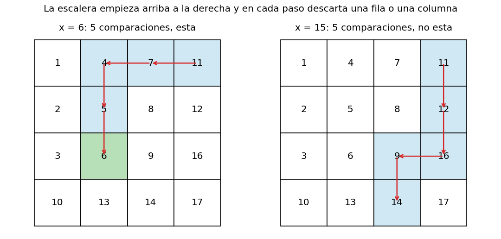
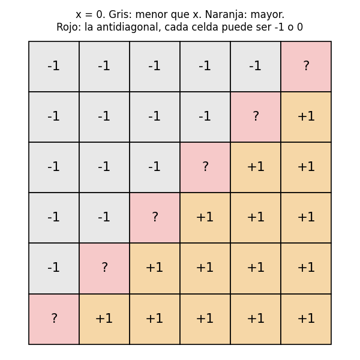
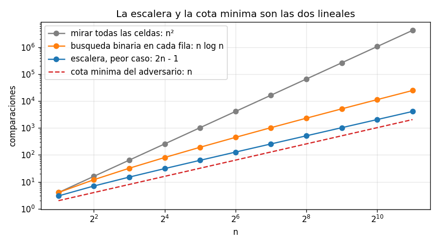

# Ejercicio 6

Una matriz $n \times n$ tiene filas y columnas ordenadas de forma creciente. Diseña un algoritmo que decida si contiene un valor $x$ en $O(n)$ comparaciones, demuestra su correctitud con un invariante, y demuestra con un adversario que no se puede en $o(n)$.

## Idea

Que las filas y las columnas estén ordenadas quiere decir que los valores crecen hacia la derecha y hacia abajo. Por ejemplo:

```
 1   4   7  11
 2   5   8  12
 3   6   9  16
10  13  14  17
```

La forma obvia es mirar las $n^2$ celdas. Un poco mejor es hacer búsqueda binaria en cada fila, que cuesta $n \log n$. Para llegar a $O(n)$ hay que aprovechar que las columnas también están ordenadas.

La clave es empezar en la esquina de arriba a la derecha. Desde ahí, hacia la izquierda los valores bajan y hacia abajo suben. Entonces, al comparar $x$ con esa celda:

- si la celda es menor que $x$, toda su fila (que está a la izquierda) también es menor, y la fila entera se puede descartar;
- si la celda es mayor que $x$, toda su columna (que está abajo) también es mayor, y la columna entera se puede descartar.

Cada comparación descarta una fila o una columna, y como hay $n$ de cada una, no puede haber más de $2n - 1$ comparaciones.

Los casos de prueba están en `ejercicio-06-casos_prueba.py`, el algoritmo en `ejercicio-06-matriz.py` y las gráficas se generan con `ejercicio-06-grafica.py`. Cada prueba tiene `assert`, así que si algo no cuadra el programa da error.

---

## Parte 1: el algoritmo

```python
def search_matrix(M, x):
    n = len(M)
    i, j = 0, n - 1
    while i < n and j >= 0:
        if M[i][j] == x:
            return (i, j)
        if M[i][j] < x:
            i += 1           # toda la fila i (hasta la columna j) es menor que x
        else:
            j -= 1           # toda la columna j (desde la fila i) es mayor que x
    return None
```

`(i, j)` es la esquina de arriba a la derecha de la parte de la matriz que todavía no se descartó. El camino que hace forma una escalera que baja hacia la izquierda.

### Ejemplo con una traza

Con la matriz de arriba:

```
x =  6: (0,3)=11  (0,2)=7  (0,1)=4  (1,1)=5  (2,1)=6  ->  (2, 1)
x = 15: (0,3)=11  (1,3)=12  (2,3)=16  (2,2)=9  (3,2)=14  ->  None
```



Para $x = 6$: 11 es mayor, se descarta la última columna; 7 también, se descarta la tercera; 4 es menor, se descarta la primera fila; 5 es menor, se descarta la segunda fila; y en la tercera fila está el 6. Para $x = 15$, la escalera termina saliéndose por abajo sin encontrarlo.

### Casos de prueba

Prueba 1: las dos trazas de arriba, comprobadas con `assert`.

Prueba 2: casos borde.

```
  matriz vacia                              OK
  1 x 1, esta                               OK
  1 x 1, no esta                            OK
  x menor que todos                         OK
  x mayor que todos                         OK
  x en la esquina de arriba a la izquierda  OK
  x en la esquina de abajo a la derecha     OK
  valores repetidos                         OK
```

---

## Parte 2: el invariante

**Invariante:** antes de cada vuelta, si $x$ está en la matriz, entonces está en la parte formada por las filas $i, i+1, \dots, n-1$ y las columnas $0, 1, \dots, j$.

#### Inicialización

Al principio $i = 0$ y $j = n - 1$: la parte es la matriz entera. ✔

#### Mantenimiento

Supongamos que el invariante se cumple, y que `M[i][j]` $\neq x$. Hay dos casos:

1. **`M[i][j]` $< x$:** la fila $i$ está ordenada, así que `M[i][0]`, ..., `M[i][j]` son todos menores o iguales que `M[i][j]`, y por lo tanto menores que $x$. Dentro de la parte que queda, $x$ no está en la fila $i$. Se puede descartar, y el algoritmo hace `i += 1`. ✔
2. **`M[i][j]` $> x$:** la columna $j$ está ordenada, así que `M[i][j]`, ..., `M[n-1][j]` son todos mayores o iguales que `M[i][j]`, y por lo tanto mayores que $x$. Dentro de la parte que queda, $x$ no está en la columna $j$. Se puede descartar, y el algoritmo hace `j -= 1`. ✔

#### Conclusión

- **Si devuelve `(i, j)`:** es porque `M[i][j]` $= x$, así que la respuesta es correcta.
- **Si devuelve `None`:** es porque $i = n$ o $j = -1$, o sea, la parte que queda no tiene filas o no tiene columnas. Por el invariante, si $x$ estuviera en la matriz estaría en una parte vacía, lo cual es imposible. Así que $x$ no está. ✔

### ¿Por qué arriba a la derecha?

La esquina importa. Desde arriba a la izquierda, los valores crecen hacia la derecha y hacia abajo. Si la celda es menor que $x$, $x$ puede estar a la derecha o abajo, y no se puede descartar ni la fila ni la columna: el invariante no se puede mantener. Lo mismo pasa abajo a la derecha. Las dos esquinas que sirven son las que tienen una dirección que sube y otra que baja: arriba a la derecha y abajo a la izquierda.

### Casos de prueba

Prueba 3: el invariante vigilado. En cada paso se comprueba con `assert` que, si $x$ está en la matriz, está en las filas $i..n-1$ y las columnas $0..j$. Son 2000 matrices al azar, de tamaños 1 a 12:

```
invariante comprobado en 11,591 pasos, sin fallos
```

Prueba 4: contra un oráculo que mira todas las celdas, en matrices al azar:

```
5000 busquedas en matrices al azar: 0 fallos
```

Prueba 7: la versión que empieza arriba a la izquierda (y avanza a la derecha cuando la celda es menor):

```
                     x  busquedas   fallos
   x esta en la matriz       3000     1901
             x no esta       3000        0
contraejemplo: [[1, 2], [3, 4]], x = 3 -> None  (esta en (1, 0))
```

Cuando $x$ no está, la versión equivocada siempre acierta, porque nunca encuentra nada y dice "no está". Las pruebas que solo buscan valores ausentes no lo detectan. Falla en el 63% de las búsquedas de valores que sí están.

---

## Parte 3: el potencial y el costo

$$\Phi = (n - i) + (j + 1)$$

Es la cantidad de filas más la cantidad de columnas que quedan por descartar.

- **Empieza en $2n$:** $i = 0$ y $j = n - 1$.
- **Baja 1 en cada vuelta:** cada vuelta sin encontrar $x$ hace `i += 1` o `j -= 1`.
- **El ciclo sigue solo si quedan filas y columnas:** $n - i \geq 1$ y $j + 1 \geq 1$, o sea, $\Phi \geq 2$.

Así que el algoritmo termina. Como $\Phi$ empieza en $2n$, baja 1 por vuelta y el ciclo necesita $\Phi \geq 2$, hay a lo sumo $2n - 1$ vueltas, cada una con una comparación (de tres resultados: menor, igual o mayor). El costo es $O(n)$. La memoria es $O(1)$: solo `i` y `j`.

El peor caso $2n - 1$ se alcanza: en la matriz del adversario de la parte 4, sin $x$, la escalera baja y va a la izquierda alternando, y recorre $2n - 1$ celdas.

### Casos de prueba

Prueba 5: el peor caso medido en la matriz del adversario, y una comprobación en matrices al azar:

```
     n  peor caso medido  2n - 1  cota minima n  n log2 n       n^2
     1                 1       1              1         0         1
     2                 3       3              2         2         4
     4                 7       7              4         8        16
    10                19      19             10        33       100
    50                99      99             50       282     2,500
   100               199     199            100       664    10,000
   500               999     999            500      4483   250,000
en 2000 busquedas al azar nunca hay mas de 2n - 1 comparaciones
```

---

## Parte 4: la cota mínima con un adversario

El modelo: el algoritmo solo puede comparar $x$ con celdas de la matriz, y cada comparación le dice si la celda es menor, igual o mayor que $x$. El costo es la cantidad de comparaciones.

### Teorema

Todo algoritmo que decide si $x$ está en una matriz $n \times n$ con filas y columnas ordenadas hace, en el peor caso, al menos $n$ comparaciones. Por eso no se puede en $o(n)$.

### La matriz del adversario

Se toma $x = 0$ y la familia de matrices donde:

- arriba de la antidiagonal ($i + j < n - 1$) todas las celdas valen $-1$;
- abajo de la antidiagonal ($i + j > n - 1$) todas valen $+1$;
- cada celda de la antidiagonal ($i + j = n - 1$) vale $-1$ o $0$, cada una por su cuenta.



Todas estas matrices tienen filas y columnas ordenadas. En cada fila, a la izquierda de la antidiagonal hay $-1$, en la antidiagonal hay $-1$ o $0$, y a la derecha hay $+1$, y $-1 \leq \{-1, 0\} \leq +1$. Con las columnas pasa lo mismo.

Las $n$ celdas de la antidiagonal son independientes: cualquiera puede ser el 0 sin cambiar las demás.

### El adversario

El adversario contesta las comparaciones así:

- si le preguntan por una celda de arriba de la antidiagonal: "menor que $x$";
- si le preguntan por una celda de abajo: "mayor que $x$";
- si le preguntan por una celda de la antidiagonal: "menor que $x$" (como si valiera $-1$).

Siempre hay una matriz de la familia que da todas esas respuestas: la que tiene $-1$ en toda la antidiagonal.

### Demostración

Supongamos que un algoritmo termina sin haber preguntado por alguna celda $(i, n-1-i)$ de la antidiagonal. Hay dos matrices de la familia que dan exactamente las mismas respuestas a todas sus preguntas:

1. la que tiene $-1$ en toda la antidiagonal, que no contiene a $x = 0$;
2. la misma, pero con $0$ en la celda $(i, n-1-i)$, que sí contiene a $x$.

Las dos dan las mismas respuestas, porque solo difieren en una celda por la que el algoritmo nunca preguntó. Así que el algoritmo hace lo mismo con las dos y da la misma respuesta. Pero la respuesta correcta es "no está" para una y "está" para la otra. El algoritmo se equivoca en una de las dos.

Entonces un algoritmo correcto tiene que preguntar por las $n$ celdas de la antidiagonal, y eso son al menos $n$ comparaciones. ∎

### Conclusión

La escalera hace a lo sumo $2n - 1$ comparaciones y la cota mínima es $n$. Las dos son lineales, así que el problema cuesta $\Theta(n)$ y la escalera es óptima salvo por la constante.

### Casos de prueba

Prueba 6: el adversario de la demostración, programado, contra varios algoritmos con $n = 8$. Para cada uno se cuenta por cuántas celdas de la antidiagonal preguntó. Si le faltó alguna, se arma la matriz con el 0 en esa celda, se corre el algoritmo sobre ella y se comprueba con `assert` que dice "no está" aunque $x$ está:

```
                       algoritmo  comparaciones  antidiagonal vista  engañado
                        escalera             15              8 de 8        no
                todas las celdas             64              8 de 8        no
              diagonal principal              8              0 de 8        si
         fila 0 y ultima columna             16              1 de 8        si
  escalera con n-1 comparaciones              7              4 de 8        si
```

La escalera y el recorrido de todas las celdas miran toda la antidiagonal y no se dejan engañar. Los otros tres se saltan alguna celda y fallan, como dice la demostración. El de "fila 0 y última columna" hace 16 comparaciones, más que $n$, y aun así falla: no alcanza con hacer muchas comparaciones, hay que hacer las que tocan la antidiagonal.



En escala logarítmica, la escalera (azul) y la cota mínima (roja) son rectas paralelas, separadas por el factor 2. Mirar todo ($n^2$) y la búsqueda binaria por filas ($n \log n$) crecen más rápido.
