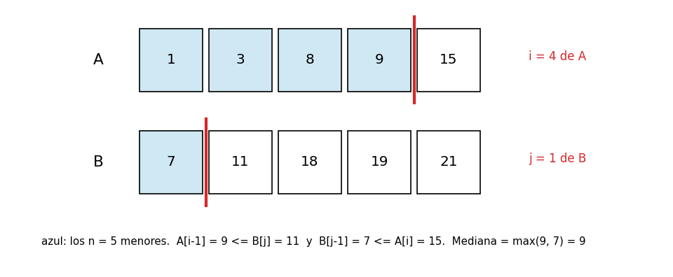
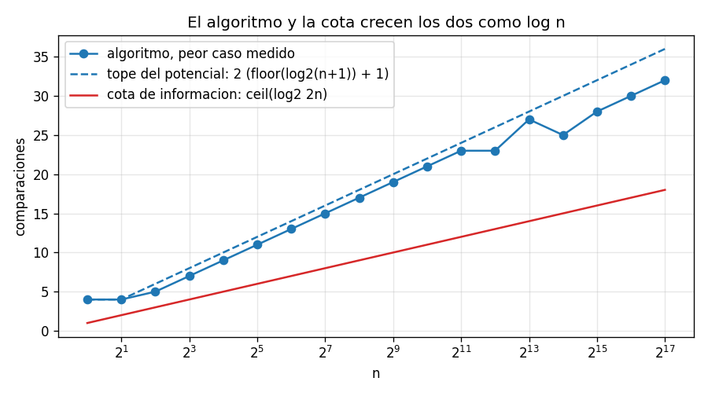

# Ejercicio 7

Mediana de dos arreglos ordenados de largo $n$: el $n$-ésimo menor de los $2n$ elementos. Diseña un algoritmo $O(\log n)$, demuestra su correctitud y da la cota de información.

## Idea

Hay dos arreglos ordenados $A$ y $B$, cada uno con $n$ elementos, y se busca el $n$-ésimo menor de los $2n$ juntos. Por ejemplo, con

```
A = [1, 3, 8, 9, 15]
B = [7, 11, 18, 19, 21]
```

los diez juntos y ordenados son `1 3 7 8 9 11 15 18 19 21`, y el quinto es 9.

La forma obvia es mezclar los dos arreglos, como en mergesort, hasta llegar al elemento $n$. Eso cuesta $O(n)$. Para llegar a $O(\log n)$ hay que hacer una búsqueda binaria, pero no sobre los valores, sino sobre cuántos elementos aporta cada arreglo.

Los $n$ menores están formados por los $i$ primeros de $A$ y los $j = n - i$ primeros de $B$, para algún $i$ entre 0 y $n$. Si se encuentra ese $i$, la respuesta es el mayor de esos $n$ elementos, o sea, $\max(A[i-1], B[j-1])$. En el ejemplo, $i = 4$ y $j = 1$:



Los casos de prueba están en `ejercicio-07-casos_prueba.py`, el algoritmo en `ejercicio-07-mediana.py` y las gráficas se generan con `ejercicio-07-grafica.py`. Cada prueba tiene `assert`, así que si algo no cuadra el programa da error.

---

## Parte 1: el algoritmo

Un corte es un número $i$ entre 0 y $n$: se toman los $i$ primeros de $A$ y los $j = n - i$ primeros de $B$. El corte es válido si

$$A[i-1] \leq B[j] \quad\text{y}\quad B[j-1] \leq A[i]$$

o sea, si lo que se tomó de cada arreglo no es mayor que lo que no se tomó del otro. Cuando un lado no tiene elementos se usan centinelas: $A[-1] = -\infty$ si $i = 0$, $A[n] = +\infty$ si $i = n$, y lo mismo con $B$.

```python
def median_two(A, B):
    n = len(A)
    lo, hi = 0, n
    while True:
        i = (lo + hi) // 2
        j = n - i
        a_left = A[i - 1] if i > 0 else -INF
        a_right = A[i] if i < n else INF
        b_left = B[j - 1] if j > 0 else -INF
        b_right = B[j] if j < n else INF
        if a_left > b_right:           # se tomaron demasiados de A
            hi = i - 1
        elif b_left > a_right:         # se tomaron muy pocos de A
            lo = i + 1
        else:                          # corte válido
            return max(a_left, b_left)
```

Si $A[i-1] > B[j]$, el último que se tomó de $A$ es más grande que uno que no se tomó de $B$: hay que tomar menos de $A$. Si $B[j-1] > A[i]$, pasa lo contrario: hay que tomar más de $A$.

### Ejemplo con una traza

```
A = [1, 3, 8, 9, 15]  B = [7, 11, 18, 19, 21]  (n = 5: el 5o menor de los 10)
 lo  hi   i   j  A[i-1]  A[i]  B[j-1]  B[j]   decision
  0   5   2   3       3     8      18    19   B[j-1] > A[i]: muy pocos de A
  3   5   4   1       9    15       7    11   corte valido: max(9, 7) = 9
todos juntos y ordenados: [1, 3, 7, 8, 9, 11, 15, 18, 19, 21] -> el 5o es 9
```

Con $i = 2$ se toman `1 3` de $A$ y `7 11 18` de $B$, pero 18 es mayor que 8, que quedó afuera: hacen falta más de $A$. Con $i = 4$ se toman `1 3 8 9` y `7`, y todo lo que queda afuera (`15` y `11 18 19 21`) es mayor o igual. La respuesta es $\max(9, 7) = 9$.

### Casos de prueba

Prueba 1: la traza de arriba, comprobada con `assert`.

Prueba 2: casos borde.

```
  n = 1                         OK
  todo A menor que todo B       OK
  todo B menor que todo A       OK
  los dos arreglos iguales      OK
  todos iguales                 OK
  negativos                     OK
  intercalados                  OK
```

Los dos casos "todo A menor que todo B" y al revés son los extremos: el corte válido es $i = n$ (todos de $A$) o $i = 0$ (todos de $B$), y ahí entran los centinelas.

---

## Parte 2: la correctitud

La demostración tiene tres pasos: siempre existe un corte válido, un corte válido da la respuesta correcta, y la búsqueda binaria nunca pierde a los cortes válidos.

### Paso 1: siempre existe un corte válido

Se toman los $n$ menores de los $2n$ (si hay empates, cualquiera de las formas de elegirlos). Sea $i^*$ la cantidad que viene de $A$ y $j^* = n - i^*$ la que viene de $B$. Como los arreglos están ordenados, los que vienen de $A$ son los $i^*$ primeros, y los de $B$ los $j^*$ primeros.

Cada elemento elegido es menor o igual que cada elemento no elegido. En particular, $A[i^*-1]$ (elegido) $\leq B[j^*]$ (no elegido), y $B[j^*-1]$ (elegido) $\leq A[i^*]$ (no elegido). Así que $i^*$ es un corte válido. ✔

### Paso 2: un corte válido da la respuesta correcta

Si el corte $i$ es válido, cada elemento tomado es menor o igual que cada elemento no tomado:

- dentro de $A$: $A[0..i-1] \leq A[i-1] \leq A[i] \leq A[i..n-1]$, porque $A$ está ordenado;
- de $A$ contra $B$: $A[0..i-1] \leq A[i-1] \leq B[j] \leq B[j..n-1]$, por la primera condición;
- de $B$ contra $A$ y dentro de $B$: igual, con la segunda condición.

Entonces los $n$ tomados son los $n$ menores, y el $n$-ésimo menor es el mayor de ellos: $\max(A[i-1], B[j-1])$. ✔

### Paso 3: el invariante de la búsqueda binaria

**Invariante:** antes de cada vuelta, hay un corte válido en $[lo, hi]$.

Para el mantenimiento hace falta un lema: las dos condiciones son monótonas.

- Si $A[i-1] > B[j]$ en el corte $i$, también vale en cualquier corte mayor: al tomar uno más de $A$, $A[i]$ es mayor o igual que $A[i-1]$, y $B[j-1]$ es menor o igual que $B[j]$. Así que ningún corte $\geq i$ es válido.
- Si $B[j-1] > A[i]$ en el corte $i$, también vale en cualquier corte menor, por la misma razón. Ningún corte $\leq i$ es válido.

#### Inicialización

$lo = 0$ y $hi = n$ cubren todos los cortes posibles, y por el paso 1 alguno es válido. ✔

#### Mantenimiento

Supongamos que hay un corte válido en $[lo, hi]$ y que el corte $i$ del medio no es válido.

1. **Si $A[i-1] > B[j]$:** por el lema, ningún corte $\geq i$ es válido, así que el corte válido está en $[lo, i-1]$, que es el rango nuevo. ✔
2. **Si $B[j-1] > A[i]$:** por el lema, ningún corte $\leq i$ es válido, así que el corte válido está en $[i+1, hi]$. ✔

Las dos condiciones no pueden valer a la vez, porque quedaría $A[i-1] > B[j] \geq B[j-1] > A[i] \geq A[i-1]$, que es imposible.

#### Conclusión

El rango nunca se vacía (siempre tiene un corte válido), así que el algoritmo solo puede terminar encontrando un corte válido, y por el paso 2 la respuesta es correcta. ∎

### Casos de prueba

Prueba 3: el invariante vigilado. Para cada arreglo se calculan por fuerza bruta todos los cortes válidos, se comprueba que existe alguno, y antes de cada vuelta se comprueba con `assert` que alguno está en $[lo, hi]$:

```
invariante comprobado en 7,192 vueltas, sin fallos
```

Prueba 4: contra un oráculo que junta los dos arreglos, los ordena y toma el $n$-ésimo. Con valores casi sin repetir y con muchos repetidos:

```
                   valores  casos  fallos
 al azar, casi sin repetir   4000       0
con muchos repetidos (0..3)   4000       0
```

---

## Parte 3: el costo

El potencial es $\Phi = hi - lo + 1$, la cantidad de cortes que quedan en el rango. Empieza en $n + 1$, y como cada vuelta se queda con la mitad de la izquierda o de la derecha del medio, en cada vuelta queda en a lo sumo la mitad. Es la misma cuenta que la búsqueda binaria del ejercicio 2: hay a lo sumo $\lfloor \log_2 (n+1) \rfloor + 1$ vueltas.

Cada vuelta hace a lo sumo 2 comparaciones, así que el total es a lo sumo $2(\lfloor \log_2 (n+1) \rfloor + 1)$: $O(\log n)$. La memoria es $O(1)$.

### Casos de prueba

Prueba 5: el peor caso medido en arreglos al azar, contra el tope y contra la cota de la parte 4:

```
       n  peor medido  2*(floor(log2(n+1))+1)  cota ceil(log2 2n)   mezclar
       1            4                       4                   1         1
       2            4                       4                   2         2
       4            6                       6                   3         4
      10            7                       8                   5        10
     100           13                      14                   8       100
   1,000           19                      20                  11     1,000
 100,000           31                      34                  18   100,000
```

Con $n = 100\,000$, el algoritmo hace 31 comparaciones y mezclar haría 100 000.

---

## Parte 4: la cota de información

El modelo es el de comparaciones (conferencia 5): el algoritmo solo puede comparar elementos entre sí, y su costo es la cantidad de comparaciones. Si todos los valores son distintos, cada comparación tiene dos respuestas, y el algoritmo es un árbol de decisión binario.

### Cualquiera de los $2n$ elementos puede ser la respuesta

La salida del algoritmo es cuál de los $2n$ elementos es la mediana. Hay que ver que cada uno puede serlo:

- **$A[k]$ es la respuesta** si hay exactamente $n - 1$ elementos menores que él. Los $k$ primeros de $A$ ya son menores. Hacen falta $n - 1 - k$ de $B$, y eso se puede porque $0 \leq n - 1 - k \leq n - 1$: basta poner los $n - 1 - k$ primeros de $B$ por debajo de $A[k]$ y el resto por encima.
- **$B[k]$ es la respuesta** por el mismo argumento.

### Cada respuesta necesita su propia hoja

Como en el lema 2 de la conferencia 5:

- **La salida depende solo de la hoja:** el algoritmo no ve los valores, solo las respuestas a las comparaciones. Dos entradas que reciben las mismas respuestas llegan a la misma hoja y reciben la misma salida.
- **Respuestas distintas necesitan salidas distintas:** si en una entrada la mediana es $A[3]$ y en otra es $B[1]$, una misma salida está mal para una de las dos.

Entonces el árbol tiene al menos $2n$ hojas, y un árbol binario de altura $h$ tiene a lo sumo $2^h$ hojas (conferencia 5, lema 1). Así que

$$h \geq \lceil \log_2 (2n) \rceil = 1 + \lceil \log_2 n \rceil$$

Todo algoritmo de comparaciones hace al menos $\lceil \log_2 (2n) \rceil$ comparaciones en el peor caso. ∎

### Conclusión

El algoritmo hace a lo sumo $2(\lfloor \log_2 (n+1) \rfloor + 1)$ comparaciones y la cota es $\lceil \log_2 (2n) \rceil$. Las dos son $\Theta(\log n)$, así que el algoritmo es óptimo salvo por una constante. Se separan por un factor 2, porque el algoritmo hace dos comparaciones por vuelta.



### Casos de prueba

Prueba 6: para $n$ de 1 a 5 se prueban todas las formas de intercalar los dos arreglos ($\binom{2n}{n}$), y se anota en qué posición queda la respuesta:

```
  n = 1:   2 intercalados, la respuesta aparece en  2 posiciones distintas (2n = 2)
  n = 2:   6 intercalados, la respuesta aparece en  4 posiciones distintas (2n = 4)
  n = 3:  20 intercalados, la respuesta aparece en  6 posiciones distintas (2n = 6)
  n = 4:  70 intercalados, la respuesta aparece en  8 posiciones distintas (2n = 8)
  n = 5: 252 intercalados, la respuesta aparece en 10 posiciones distintas (2n = 10)
```

Siempre aparecen las $2n$ posiciones, como dice la demostración.

---

## Parte 5: olvidar los centinelas

En Python, `A[i - 1]` con $i = 0$ no da error: devuelve `A[-1]`, que es el último elemento. Una versión que olvida los centinelas de la izquierda funciona casi siempre, pero cuando el corte válido es $i = 0$ o $j = 0$ usa un valor equivocado sin avisar.

La demostración dice cuándo pasa: los centinelas solo se usan en los cortes de los extremos, o sea, cuando todos los $n$ menores vienen del mismo arreglo. Eso pasa cuando un arreglo entero es menor que el otro.

### Casos de prueba

Prueba 7: la versión sin centinelas a la izquierda, con distintas entradas:

```
                      entradas  casos   fallos
         al azar, n de 20 a 50   3000     0.0%
           al azar, n de 1 a 3   3000    42.1%
       todo B menor que todo A   3000   100.0%
contraejemplo: A = [7, 8, 9]  B = [1, 2, 3] -> sin centinelas: 9  correcto: 3
```

Con arreglos al azar grandes, el corte válido casi nunca está en un extremo, y la versión con el error pasa todas las pruebas. Con arreglos chicos falla seguido, y cuando todo $B$ es menor que todo $A$ falla siempre. En el contraejemplo, el corte válido es $i = 0$, y en vez de $-\infty$ se usa `A[-1]` $= 9$.
