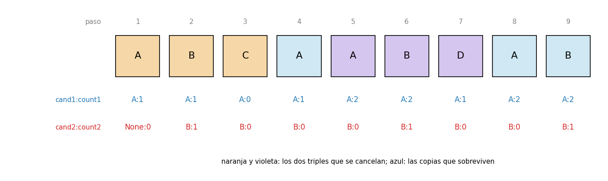
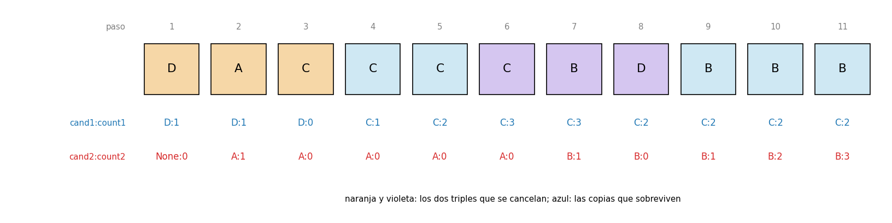
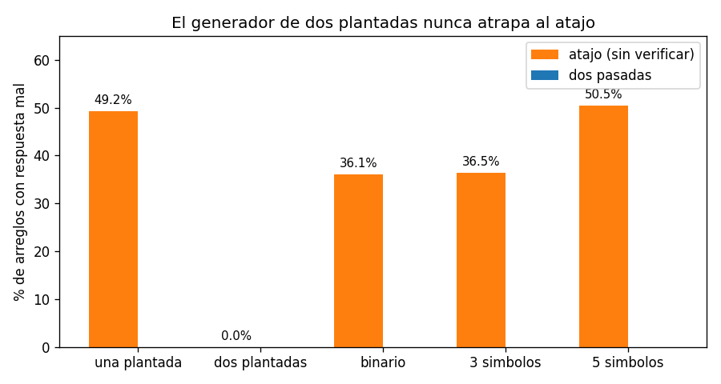

# Ejercicio 8

El elemento que aparece más de $n/3$ veces. Generaliza Boyer-Moore con dos candidatos, enuncia el invariante reforzado y demuéstralo. Después escribe la versión que devuelve los candidatos con contador positivo sin verificarlos, y busca un generador de pruebas que no la atrape. Cuidado: el análogo del generador binario de la conferencia 3 sí la atrapa.

## Idea

En la conferencia 3, Boyer-Moore encuentra el elemento que aparece más de $n/2$ veces con un candidato y un contador. La idea era cancelar parejas de elementos distintos: si se tachan dos elementos distintos, la mayoría sigue siendo mayoría en lo que queda.

Ahora se buscan los elementos que aparecen más de $n/3$ veces. Lo primero es ver cuántos puede haber: como mucho dos, porque si tres elementos aparecieran más de $n/3$ veces cada uno, entre los tres sumarían más de $n$ elementos. Por eso hacen falta dos candidatos, cada uno con su contador.

La cancelación ahora es de a tres: se tachan tres elementos distintos entre sí. Si un elemento $m$ aparece $k > n/3$ veces, entre los tres tachados hay a lo sumo una copia de $m$, así que quedan al menos $k - 1$ copias entre $n - 3$ elementos, y

$$k - 1 > \frac{n}{3} - 1 = \frac{n - 3}{3}$$

O sea que $m$ sigue apareciendo más de un tercio de las veces en lo que queda. Se puede seguir tachando triples hasta que no se pueda más, y lo que sobreviva son copias de a lo sumo dos elementos. Si hay respuesta, tiene que estar entre ellos.

Los casos de prueba están en `ejercicio-08-casos_prueba.py`, el algoritmo en `ejercicio-08-boyer_moore.py` y las gráficas se generan con `ejercicio-08-grafica.py`. Cada prueba tiene `assert`, así que si algo no cuadra el programa da error.

---

## Parte 1: el algoritmo

```python
def more_than_third(A):
    cand1, count1 = None, 0
    cand2, count2 = None, 0
    for x in A:                       # primera pasada: cancelar de a tres
        if x == cand1:
            count1 += 1
        elif x == cand2:
            count2 += 1
        elif count1 == 0:
            cand1, count1 = x, 1
        elif count2 == 0:
            cand2, count2 = x, 1
        else:
            count1 -= 1
            count2 -= 1
    # segunda pasada: verificar
    return [c for c in (cand1, cand2) if c is not None and 3 * A.count(c) > len(A)]
```

Para cada elemento $x$ hay cinco casos:

- **$x$ es el candidato 1:** una copia más, `count1` sube.
- **$x$ es el candidato 2:** una copia más, `count2` sube.
- **el contador 1 está en 0:** $x$ pasa a ser el candidato 1.
- **el contador 2 está en 0:** $x$ pasa a ser el candidato 2.
- **$x$ es distinto de los dos y los dos contadores son positivos:** $x$ se cancela con una copia de cada candidato, y los dos contadores bajan.

El orden de los `if` importa: primero se compara con los dos candidatos, y solo después se mira si algún contador está en 0. Si se hace al revés, un mismo valor puede quedar en los dos candidatos. Por ejemplo, con `A A` el primer `A` ocupa el candidato 1 y el segundo ocupa el candidato 2, y la respuesta sale repetida. En la parte 2 se ve que la demostración necesita que los dos candidatos sean distintos.

### Ejemplo con una traza

Con el arreglo `A B C A A B D A B` ($n = 9$, hace falta aparecer más de 3 veces):



Debajo de cada elemento está el estado de los candidatos después de procesarlo. En el paso 3, la `C` se cancela con una `A` y una `B` (triple naranja). En el paso 7, la `D` se cancela con otra `A` y otra `B` (triple violeta). Sobreviven dos `A` y una `B` (en azul).

Al final los candidatos son `A` (contador 2) y `B` (contador 1). La segunda pasada cuenta: `A` aparece 4 veces, que es más de 3, así que es respuesta. `B` aparece 3 veces, que no es más de 3, así que no lo es. La respuesta es `[A]`. `B` tenía contador positivo y aun así no es respuesta: eso es lo que hace falta para la parte 4.

### Segundo ejemplo: dos respuestas y candidatos que cambian

En el ejemplo anterior hay una sola respuesta, y los candidatos son `A` y `B` desde el paso 2 hasta el final. En este segundo ejemplo hay dos respuestas, y los dos lugares de candidato cambian de valor durante la ejecución.

Con el arreglo `D A C C C C B D B B B` ($n = 11$, hace falta aparecer más de $11/3 \approx 3.67$ veces, o sea 4 o más):



- En los pasos 1 y 2, `D` y `A` ocupan los dos lugares de candidato.
- En el paso 3, la `C` es distinta de los dos y los dos contadores son positivos, así que se cancela con `D` y `A` (triple naranja). Los dos contadores quedan en 0.
- En el paso 4, el contador 1 está en 0, así que `C` reemplaza a `D` como candidato 1. En los pasos 5 y 6 llegan dos `C` más, y `count1` sube a 3.
- En el paso 7, el contador 2 sigue en 0, así que `B` reemplaza a `A` como candidato 2.
- En el paso 8, la `D` se cancela con una `C` y una `B` (triple violeta).
- En los pasos 9 a 11 llegan tres `B`, y `count2` sube a 3.

Al final los candidatos son `C` (contador 2) y `B` (contador 3). La segunda pasada cuenta: `C` aparece 4 veces y `B` también, y las dos pasan de $11/3$. La respuesta es `[C, B]`.

`D` y `A` fueron candidatos al principio y no aparecen en la respuesta. El candidato del principio no tiene por qué ser el del final: un lugar queda libre cada vez que su contador llega a 0, y lo ocupa el siguiente elemento distinto que llega.

### Casos de prueba

Prueba 1: la traza de arriba, paso a paso.

```
 paso   x  cand1  count1  cand2  count2
    1   A      A       1   None       0
    2   B      A       1      B       1
    3   C      A       0      B       0
    4   A      A       1      B       0
    5   A      A       2      B       0
    6   B      A       2      B       1
    7   D      A       1      B       0
    8   A      A       2      B       0
    9   B      A       2      B       1
respuesta: ['A']  (n = 9, hace falta aparecer mas de 3 veces)
```

En el paso 4, `A` vuelve a contar como candidato 1 aunque su contador estaba en 0, porque primero se compara con los candidatos.

Prueba 1b: el segundo ejemplo, comprobando con `assert` que el candidato 1 pasa de `D` a `C`, que el candidato 2 pasa de `A` a `B` y que la respuesta tiene los dos.

```
 paso   x  cand1  count1  cand2  count2
    1   D      D       1   None       0
    2   A      D       1      A       1
    3   C      D       0      A       0
    4   C      C       1      A       0
    5   C      C       2      A       0
    6   C      C       3      A       0
    7   B      C       3      B       1
    8   D      C       2      B       0
    9   B      C       2      B       1
   10   B      C       2      B       2
   11   B      C       2      B       3
respuesta: ['C', 'B']  (n = 11, hace falta aparecer mas de 11/3, o sea 4 o mas)
```

Prueba 2: casos borde.

```
  arreglo vacio: no hay respuesta                     OK
  un elemento: es respuesta (1 > 1/3)                 OK
  dos distintos: los dos son respuesta (1 > 2/3)      OK
  tres distintos: ninguno (1 no es > 1)               OK
  A A B: solo A                                       OK
  A A B B C: dos respuestas                           OK
  cada uno exactamente n/3 veces: ninguno             OK
  numeros: 7 aparece 3 de 6 veces                     OK
  palabras                                            OK
```

El de "exactamente $n/3$ veces" es importante: hace falta aparecer más de $n/3$ veces, no $n/3$ o más.

---

## Parte 2: el invariante reforzado

### Un invariante que no alcanza

La primera opción es la frase que se quiere al final, aplicada a cada prefijo: "si un elemento aparece más de un tercio de las veces en el prefijo, entonces es uno de los candidatos". Es verdadera, pero no se puede demostrar por inducción tal como está. Si el prefijo de largo $i$ no tiene ningún elemento así, la frase no dice nada sobre los candidatos, y el prefijo de largo $i+1$ sí puede tener uno. Es el mismo problema que la sección 4 de la conferencia 3: el invariante tiene que ser inductivo, no solo verdadero.

### El invariante reforzado

Es la idea de cancelación de la sección "Idea", escrita como una afirmación sobre el estado. Después de procesar el prefijo $A[1..i]$:

- **(a)** los dos candidatos son distintos: `cand1` $\neq$ `cand2`;
- **(b)** el prefijo se puede partir en triples de tres elementos distintos entre sí, más `count1` copias de `cand1`, más `count2` copias de `cand2`.

Por ejemplo, en la traza, después del paso 9 el arreglo se parte en los triples (A, B, C) y (A, B, D), más 2 copias de `A` y 1 copia de `B`.

#### Inicialización

Antes de empezar el prefijo está vacío, los dos contadores están en 0 y los candidatos son `None`: cero triples y cero copias. ✔

#### Mantenimiento

Supongamos que el invariante se cumple para $A[1..i]$, y se procesa $x = A[i+1]$. Hay un caso por cada rama del `if`:

1. **$x$ = `cand1`:** `count1` sube 1, y $x$ es una copia más de `cand1`. Los triples no cambian.
2. **$x$ = `cand2`:** igual que el anterior, con el candidato 2.
3. **$x$ es distinto de los dos y `count1` = 0:** como `count1` es 0, no había copias de `cand1` en la partición, así que al cambiar el candidato no se pierde nada. $x$ pasa a ser `cand1` con una copia. Y `cand1` $\neq$ `cand2`, porque $x$ era distinto de `cand2`.
4. **$x$ es distinto de los dos y `count2` = 0:** igual que el anterior, con el candidato 2.
5. **$x$ es distinto de los dos y los dos contadores son positivos:** se forma un triple nuevo con $x$, una copia de `cand1` y una copia de `cand2`. Los tres son distintos entre sí: $x \neq$ `cand1`, $x \neq$ `cand2` y, por (a), `cand1` $\neq$ `cand2`. Los dos contadores bajan 1, que es justo lo que hace el algoritmo.

En el caso 5 se usa la parte (a). Sin ella, el "triple" podría tener dos elementos iguales y la partición dejaría de ser de elementos distintos. Por eso el orden de los `if` importa.

#### Conclusión

Al terminar, el arreglo entero se parte en $T$ triples de elementos distintos, más `count1` copias de `cand1` y `count2` copias de `cand2`. Contando elementos:

$$3T + \texttt{count1} + \texttt{count2} = n \quad\Rightarrow\quad T \leq \frac{n}{3}$$

#### Teorema

Si un elemento $m$ aparece más de $n/3$ veces, entonces $m$ es uno de los candidatos, y además con contador positivo.

Demostración: supongamos que $m$ no es un candidato con contador positivo. Entonces $m$ no tiene copias sueltas en la partición, así que solo aparece dentro de los triples. Como los tres elementos de un triple son distintos, $m$ aparece a lo sumo una vez por triple. En total, a lo sumo $T \leq n/3$ veces. Eso contradice que aparece más de $n/3$ veces. ∎

Es el mismo argumento que la conferencia 3 usa con las parejas, cambiando parejas por triples.

#### La segunda pasada

El teorema dice que todas las respuestas están entre los dos candidatos, pero no dice que los candidatos sean respuestas. Por eso la segunda pasada cuenta cuántas veces aparece cada candidato y se queda solo con los que pasan de $n/3$. Así:

- toda respuesta está entre los candidatos (por el teorema), así que no se pierde ninguna;
- todo lo que se devuelve fue contado y pasa de $n/3$, así que no sobra ninguno.

La respuesta es exactamente el conjunto de elementos que aparecen más de $n/3$ veces.

#### Terminación

Cada pasada recorre el arreglo una vez. El potencial es la cantidad de elementos que faltan por procesar: empieza en $n$, baja 1 en cada vuelta y nunca es negativo. Así que termina.

### Casos de prueba

Prueba 3: el invariante vigilado. Como en la sección 4 de la conferencia 3, después de cada paso se quitan las `count1` copias de `cand1` y las `count2` copias de `cand2`, y se comprueba con `assert` que lo que queda se puede partir en triples de distintos y que `cand1` $\neq$ `cand2`.

Para revisar la partición se usa la misma idea que la conferencia 3: un grupo de elementos se puede partir en triples de distintos si su tamaño es múltiplo de 3 y ningún elemento aparece más de un tercio de las veces. (Se ordena el grupo y se junta la posición $i$ con la $i + T$ y la $i + 2T$.)

```
invariante comprobado en 24,459 prefijos, sin fallos
```

Prueba 4: contra un oráculo que cuenta todo con un `Counter`, con varios generadores de arreglos:

```
      generador   casos  fallos
   una plantada    4000       0
  dos plantadas    4000       0
        binario    4000       0
     3 simbolos    4000       0
     5 simbolos    4000       0
```

---

## Parte 3: el costo

- **Tiempo:** la primera pasada hace a lo sumo 2 comparaciones por elemento (con `cand1` y con `cand2`). La segunda pasada cuenta los dos candidatos, y cada conteo recorre el arreglo, o sea $2n$ comparaciones más. En total, a lo sumo $4n$ comparaciones: $O(n)$.
- **Memoria:** dos candidatos y dos contadores, sin importar el tamaño del arreglo: $O(1)$.

La forma obvia, contar todo con un diccionario, también es $O(n)$ en tiempo, pero guarda una entrada por cada elemento distinto, así que puede usar $O(n)$ memoria.

### Casos de prueba

Prueba 5: se cuentan las comparaciones con `==` en arreglos al azar, y se comparan las 4 variables del algoritmo con las entradas que guarda el oráculo:

```
       n  comparaciones  por elemento  variables  entradas del oraculo
      10             38          3.80          4                     9
     100            397          3.97          4                    64
   1,000          3,998          4.00          4                   636
  10,000         39,996          4.00          4                 6,320
 100,000        399,997          4.00          4                63,298
```

Nunca pasa de 4 comparaciones por elemento, y siempre usa 4 variables.

---

## Parte 4: el atajo sin verificar

Una variante es ahorrarse la segunda pasada y devolver directamente los candidatos que terminaron con contador positivo:

```python
def more_than_third_shortcut(A):
    # misma primera pasada que antes
    ...
    return [c for c, k in ((cand1, count1), (cand2, count2)) if k > 0]
```

### La mitad que sí es correcta

Por el teorema, todo elemento que aparece más de $n/3$ veces es un candidato con contador positivo. Así que el atajo nunca se olvida de una respuesta. Lo que puede pasar es lo contrario: que devuelva un candidato de más, con contador positivo pero que no aparece más de $n/3$ veces. Ya pasó en la traza de la parte 1: `B` terminó con contador 1 pero aparece exactamente 3 veces de 9, y el atajo devolvería `[A, B]`.

El contraejemplo más chico es `A A B`. Con solo dos símbolos nunca hay tres elementos distintos, así que no se cancela nada: `A` termina con contador 2 y `B` con contador 1. El atajo devuelve `[A, B]`, pero `B` aparece 1 vez de 3, que no es más de 1.

### Un generador que no lo atrapa

El generador "dos plantadas" arma arreglos donde dos elementos distintos aparecen más de $n/3$ veces cada uno, y el resto es cualquier cosa. Contra ese generador el atajo nunca falla, y la razón es la siguiente:

1. Por el teorema, los dos elementos plantados son candidatos con contador positivo.
2. Solo hay dos lugares de candidato, así que los dos candidatos son justo esos dos.
3. El atajo devuelve los candidatos con contador positivo, o sea, exactamente los dos plantados, que es la respuesta correcta.

Es lo mismo que pasaba en la conferencia 3 con el generador de "mayoría plantada": si todos los arreglos de prueba cumplen la hipótesis del teorema ("hay elementos que aparecen más de $n/3$ veces") hasta llenar los dos lugares, el atajo es correcto en todos ellos.

### Por qué el generador binario sí lo atrapa

En la conferencia 3, con dos símbolos el atajo de la mayoría nunca se equivocaba, porque el contador final era la diferencia entre las dos cuentas. Aquí pasa lo contrario. Con dos símbolos nunca hay tres elementos distintos, así que nunca se cancela nada, y los contadores terminan siendo las cuentas exactas de cada símbolo. El atajo devuelve todos los símbolos que aparecen al menos una vez, aunque aparezcan pocas veces, como `B` en `A A B`. Falla cada vez que uno de los dos símbolos aparece $n/3$ veces o menos.

### Casos de prueba

Prueba 6: el atajo y la versión con dos pasadas, contra el oráculo, con cada generador:

```
      generador    atajo  dos pasadas
   una plantada    49.2%         0.0%
  dos plantadas     0.0%         0.0%
        binario    36.1%         0.0%
     3 simbolos    36.5%         0.0%
     5 simbolos    50.5%         0.0%
```



El generador de dos plantadas no lo atrapa nunca. El binario, que en la conferencia 3 no atrapaba al atajo, aquí lo atrapa en más de un tercio de los casos.

Prueba 7: el contraejemplo más chico, ejecutado.

```
A A B: atajo -> ['A', 'B']  correcto -> ['A']
```

Igual que en la conferencia 3, la demostración dice qué hay que probar. El teorema empieza con "si un elemento aparece más de $n/3$ veces", y el atajo solo se equivoca en lo que esa hipótesis no cubre: candidatos que llegan al final con contador positivo sin ser respuesta. Para atraparlo hay que probar arreglos con menos de dos respuestas.
