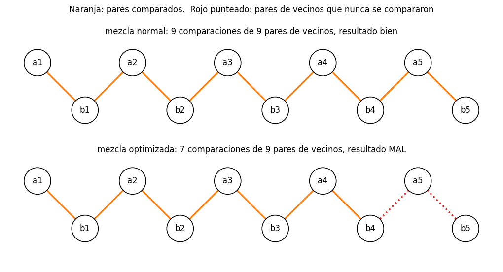
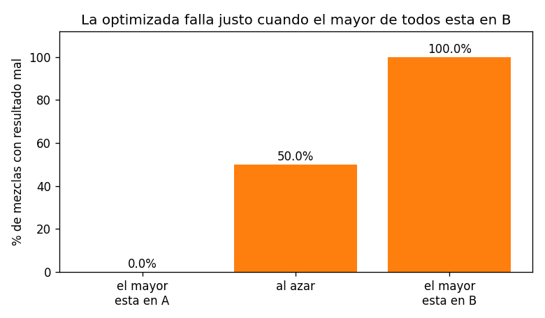

# Ejercicio 9

Una mezcla "optimizada" de dos listas ordenadas de largo $n$ deja de comparar cuando a la primera lista le queda un solo elemento, y lo pone al final. Cuenta cuántas comparaciones hace en el peor caso. Sin probarla, usa la sección 6 de la conferencia 5 para decidir si es correcta, y construye con el adversario la entrada en la que falla.

## Idea

La mezcla de siempre (la de mergesort) compara el primer elemento que queda de cada lista y saca el menor, hasta que una lista se acaba. En el peor caso hace $2n - 1$ comparaciones.

La versión "optimizada" se ahorra trabajo: cuando a la primera lista $A$ le queda un solo elemento, deja de comparar, copia lo que queda de $B$ y pone ese último elemento de $A$ al final. Parece razonable, porque el último de $A$ es el mayor de $A$.

La conferencia 5 (sección 6) demuestra que mezclar dos listas de largo $n$ necesita $2n - 1$ comparaciones en el peor caso. Si la versión optimizada hace menos, tiene que estar mal en alguna entrada, sin necesidad de probarla. Y la demostración de la cota dice cuál es esa entrada.

Los casos de prueba están en `ejercicio-09-casos_prueba.py`, las dos mezclas en `ejercicio-09-mezcla.py` y las gráficas se generan con `ejercicio-09-grafica.py`. Cada prueba tiene `assert`, así que si algo no cuadra el programa da error.

---

## Parte 1: el algoritmo

```python
def merge_optimized(A, B):
    R, i, j = [], 0, 0
    while len(A) - i > 1 and j < len(B):   # para cuando a A le queda uno
        if A[i] <= B[j]:
            R.append(A[i])
            i += 1
        else:
            R.append(B[j])
            j += 1
    if j == len(B):                        # B se acabó antes: lo que queda de A va al final
        return R + A[i:]
    return R + B[j:] + A[i:]               # A tiene un solo elemento: va al final
```

La única diferencia con la mezcla normal es la condición del `while`: la normal sigue mientras a $A$ le quede al menos un elemento (`i < len(A)`), y esta para cuando le queda uno.

### Ejemplos con trazas

```
A = [1, 5, 9]  B = [2, 3, 4]
  compara: 1vs2  5vs2  5vs3  5vs4
  resultado: [1, 2, 3, 4, 5, 9]  (4 comparaciones)  bien
A = [0, 2, 4]  B = [1, 3, 5]
  compara: 0vs1  2vs1  2vs3
  resultado: [0, 1, 2, 3, 5, 4]  (3 comparaciones)  MAL
```

En el primer ejemplo funciona: el último de $A$ (el 9) es el mayor de todos. En el segundo, el último de $A$ es 4 y queda después del 5, que es mayor.

---

## Parte 2: cuántas comparaciones hace

Cada comparación saca un elemento de $A$ o uno de $B$.

- De $A$ se pueden sacar a lo sumo $n - 1$ elementos con comparaciones: cuando queda uno, el ciclo para.
- De $B$ se pueden sacar a lo sumo $n$.
- El ciclo para en cuanto se llega a cualquiera de los dos límites.

Antes de la última comparación todavía no se llegó a ningún límite, así que se sacaron a lo sumo $n - 2$ de $A$ y $n - 1$ de $B$. Contando la última, el total es a lo sumo

$$(n - 2) + (n - 1) + 1 = 2n - 2$$

Y se alcanza: en el primer ejemplo de la parte 1, `A = [1, 5, 9]` y `B = [2, 3, 4]`, hace 4 comparaciones, que es $2n - 2$ con $n = 3$. La prueba 2 muestra que para todo $n \leq 8$ hay entradas con $2n - 2$.

La mezcla optimizada hace a lo sumo $2n - 2$ comparaciones, una menos que la normal.

### Casos de prueba

Prueba 2: el peor caso exacto, probando todas las formas de intercalar dos listas de largo $n$ (son $\binom{2n}{n}$):

```
  n  intercalados  optimizada  mezcla normal  cota 2n - 1
  1             2           0              1            1
  2             6           2              3            3
  3            20           4              5            5
  4            70           6              7            7
  5           252           8              9            9
  6           924          10             11           11
  7          3432          12             13           13
  8         12870          14             15           15
```

---

## Parte 3: decidir si es correcta, sin probarla

La conferencia 5 (sección 6) demuestra:

**Teorema.** Todo algoritmo de comparaciones que mezcla dos listas ordenadas de largo $n$ hace al menos $2n - 1$ comparaciones en el peor caso.

La mezcla optimizada hace a lo sumo $2n - 2$ en todas las entradas. Si fuera correcta, sería un algoritmo de mezcla que en el peor caso hace menos de $2n - 1$, y eso contradice el teorema. Así que no es correcta: hay al menos una entrada en la que da un resultado mal.

Esto sale sin correr nada, solo contando. Es lo que la conferencia 5 (sección 8) llama usar la cota mínima como detector de errores: un algoritmo que dice hacer menos trabajo que una cota demostrada está mal, aunque pase las pruebas.

---

## Parte 4: la entrada en la que falla, construida con el adversario

### El adversario de la conferencia 5

El adversario contesta como si la entrada fuera la intercalada perfecta:

$$a_1 < b_1 < a_2 < b_2 < \dots < a_n < b_n$$

Esa cadena tiene $2n - 1$ pares de vecinos ($a_1 b_1$, $b_1 a_2$, $a_2 b_2$, ..., $a_n b_n$), y cada par tiene un elemento de cada lista. La demostración del teorema dice que si un algoritmo no compara algún par de vecinos, se pueden intercambiar sus valores sin que cambie ninguna respuesta, y la salida correcta cambia.

### Qué pares no compara la optimizada

En la intercalada perfecta, la optimizada saca $a_1, b_1, a_2, \dots, b_{n-1}$ comparando cada vecino con el siguiente, y cuando a $A$ le queda solo $a_n$ para. Nunca compara $a_n$ con nada: le faltan los pares $(b_{n-1}, a_n)$ y $(a_n, b_n)$.



Arriba, la mezcla normal compara los 9 pares de vecinos. Abajo, la optimizada compara 7 y deja sin comparar los dos pares de $a_5$.

### La entrada en la que falla

Se intercambian los valores de $a_n$ y $b_n$:

- **Las dos listas siguen ordenadas:** $a_n$ y $b_n$ son vecinos en la cadena, así que no hay nada entre ellos.
- **Todas las respuestas son iguales:** ninguna comparación de la optimizada involucra a $a_n$, y el orden de $b_n$ con los que sí compara ($a_1, \dots, a_{n-1}$) no cambia.
- **La salida correcta cambia:** en la original, $a_n$ va antes que $b_n$; en la intercambiada, va después.

Como el algoritmo recibe las mismas respuestas, hace lo mismo en las dos entradas y devuelve el mismo orden. En una de las dos se equivoca. La optimizada pone $a_n$ al final, así que acierta en la intercambiada (donde $a_n$ es el mayor) y falla en la intercalada perfecta. La entrada en la que falla es

$$A = [0, 2, 4, \dots, 2n-2], \quad B = [1, 3, 5, \dots, 2n-1]$$

### Casos de prueba

Prueba 3: la intercalada perfecta, con los pares de vecinos que la optimizada no compara:

```
  n =   1:   0 comparaciones, pares de vecinos sin comparar: [(0, 1)], resultado MAL
  n =   2:   1 comparaciones, pares de vecinos sin comparar: [(2, 1), (2, 3)], resultado MAL
  n =   5:   7 comparaciones, pares de vecinos sin comparar: [(8, 7), (8, 9)], resultado MAL
  n =  10:  17 comparaciones, pares de vecinos sin comparar: [(18, 17), (18, 19)], resultado MAL
  n = 100: 197 comparaciones, pares de vecinos sin comparar: [(198, 197), (198, 199)], resultado MAL
```

Siempre faltan los dos pares de $a_n$, y siempre falla.

Prueba 4: el intercambio del adversario. Se corre la optimizada sobre la intercalada perfecta y sobre la versión con $a_n$ y $b_n$ intercambiados, y se comprueba con `assert` que recibe exactamente las mismas respuestas y que acierta en una sola de las dos:

```
  n =  3: mismas respuestas: True, bien en la original: False, bien en la intercambiada: True
  n =  6: mismas respuestas: True, bien en la original: False, bien en la intercambiada: True
  n = 20: mismas respuestas: True, bien en la original: False, bien en la intercambiada: True
```

---

## Parte 5: cuándo falla exactamente

El último de $A$ va al final, así que el resultado es correcto si y solo si ese elemento es el mayor de todos. Si el mayor está en $B$, falla. Para verlo:

- **Si el mayor de todos está en $A$:** es $a_n$. Cuando la optimizada para, lo que queda de $B$ es menor que $a_n$, y ponerlo al final es correcto. Si en cambio $B$ se acaba antes, lo que queda de $A$ ya está ordenado y va al final, también bien.
- **Si el mayor de todos está en $B$:** es $b_n$. Para sacarlo con una comparación, $b_n$ tendría que ser menor que algún elemento de $A$, y no lo es. Así que $B$ no se acaba antes, el ciclo para con $a_n$ pendiente, y $a_n$ queda después de $b_n$. Falla.

### Casos de prueba

Prueba 5: la optimizada con distintos generadores de pruebas:

```
             pruebas  casos   fallos
  el mayor esta en A   4000     0.0%
             al azar   4000    50.0%
  el mayor esta en B   4000   100.0%
en todos los intercalados con n <= 7: falla si y solo si el mayor de todos esta en B
```



Con listas al azar falla la mitad de las veces, así que unas pocas pruebas lo encontrarían. Pero si las pruebas usan listas donde la primera tiene los valores grandes, la optimizada pasa todas. La prueba 5 también comprueba, en todos los intercalados con $n \leq 7$, que falla exactamente cuando el mayor de todos está en $B$.
