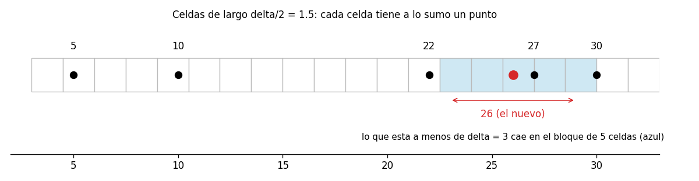
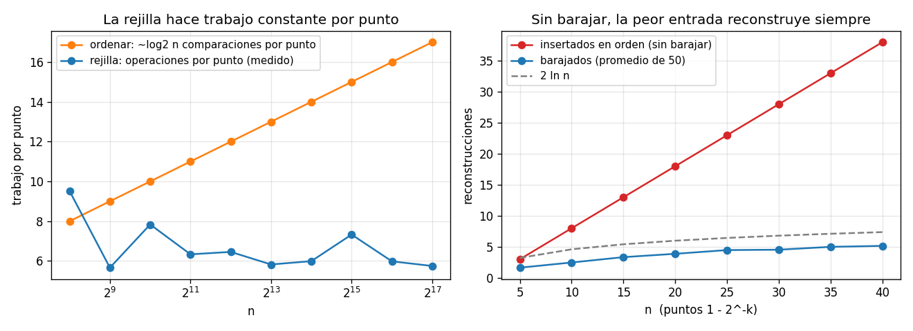

# Ejercicio 10

Par más cercano en una dimensión. Demuestra $\Omega(n \log n)$ en árboles de decisión algebraicos por reducción desde distinción de elementos. Después di qué algoritmo de la conferencia 2 rompe la cota, en qué modelo, y adáptalo a una dimensión.

## Idea

En una dimensión el par más cercano es: dados $n$ números reales, encontrar los dos que están a menor distancia. La conferencia 2 (sección 3) ya da un algoritmo: ordenar y mirar los vecinos, que cuesta $O(n \log n)$.

El ejercicio tiene dos partes que parecen contradecirse:

- **La cota mínima:** en árboles de decisión algebraicos, ningún algoritmo puede hacerlo en menos de $\Omega(n \log n)$. Sale de una reducción desde distinción de elementos, igual que la del plano en la conferencia 2 (sección 8).
- **Un algoritmo más rápido:** el algoritmo incremental aleatorio de la conferencia 2 (sección 9), adaptado a una dimensión, lo hace en tiempo esperado $O(n)$.

No hay contradicción, porque el algoritmo rápido usa operaciones que el modelo de la cota no tiene.

Los casos de prueba están en `ejercicio-10-casos_prueba.py`, los algoritmos en `ejercicio-10-par.py` y las gráficas se generan con `ejercicio-10-grafica.py`. Cada prueba tiene `assert`, así que si algo no cuadra el programa da error.

---

## Parte 1: la cota mínima por reducción

### El modelo

Un árbol de decisión algebraico (conferencia 2, sección 8) es un árbol donde cada nodo evalúa el signo de un polinomio de grado acotado en los números de la entrada, y ramifica según sea negativo, cero o positivo. El costo es la profundidad del árbol. Comparar, sumar, restar, multiplicar y medir distancias entran en el modelo.

### El problema conocido

Distinción de elementos: dados $n$ números reales $x_1, \dots, x_n$, decidir si hay dos iguales.

**Teorema (Ben-Or, 1983).** Distinción de elementos requiere $\Omega(n \log n)$ en árboles de decisión algebraicos. Se cita sin demostrar, igual que en la conferencia 2.

### La reducción

**Teorema.** El par más cercano en una dimensión requiere $\Omega(n \log n)$ en árboles de decisión algebraicos.

**Demostración.** Dada una entrada $x_1, \dots, x_n$ de distinción de elementos, se usa la misma lista como entrada del par más cercano. En una dimensión ni siquiera hay que transformar nada (en el plano había que convertir $x_i$ en el punto $(x_i, 0)$). La distancia entre $x_i$ y $x_j$ es $|x_i - x_j|$, así que

$$\text{la distancia mínima es } 0 \iff \text{hay dos } x_i \text{ iguales}$$

Supongamos que hubiera un árbol de decisión algebraico para el par más cercano con profundidad $T(n) = o(n \log n)$. Agregándole al final una prueba de signo más ("¿la distancia mínima es 0?", que es el signo de un polinomio de grado 1), se obtiene un árbol para distinción de elementos con profundidad $T(n) + 1 = o(n \log n)$. Eso contradice el teorema de Ben-Or. ∎

Conclusión: en este modelo, ordenar y mirar los vecinos, que cuesta $O(n \log n)$, es óptimo.

### Casos de prueba

Prueba 6: la reducción programada. Se decide si una lista tiene repetidos calculando el par más cercano y mirando si da 0, y se compara con contar los elementos distintos con un conjunto:

```
3000 listas: 'hay repetidos' segun el par mas cercano, contra contar con un conjunto: 0 fallos
```

---

## Parte 2: el algoritmo que rompe la cota

### Cuál es y en qué modelo

Es el algoritmo incremental aleatorio de la conferencia 2 (sección 9), de Rabin, en la versión de Kleinberg y Tardos. Inserta los puntos en orden aleatorio, mantiene $\delta$ (la distancia mínima entre los insertados) y una rejilla de celdas de lado $\delta/2$ guardada en una tabla hash.

Funciona en el modelo RAM con dos operaciones que un árbol de decisión algebraico no tiene (conferencia 2, sección 10):

- **La parte entera:** la celda de un punto se calcula con $\lfloor x / (\delta/2) \rfloor$, que no es un polinomio ni una función continua.
- **El direccionamiento indirecto:** el número de celda se usa como dirección para buscar en la tabla hash. Un árbol de decisión solo puede ramificar según el signo de un polinomio.

El azar no es lo que rompe la cota: la conferencia 2 menciona que distinción de elementos sigue costando $\Omega(n \log n)$ en árboles algebraicos aleatorizados. El azar sirve para que se esperen pocas reconstrucciones de la rejilla.

### La adaptación a una dimensión

En la recta, las celdas son intervalos de largo $\delta/2$. La celda del punto $p$ es $\lfloor p / (\delta/2) \rfloor$.

```python
def closest_pair_grid(xs):
    pts = list(xs)
    random.shuffle(pts)
    delta = abs(pts[0] - pts[1])
    side = delta / 2
    cell = lambda p: math.floor(p / side)
    grid = {cell(p): p for p in pts[:2]}
    for i in range(2, len(pts)):
        p = pts[i]
        before, c = delta, cell(p)
        for dc in (-2, -1, 0, 1, 2):               # el bloque de 5 celdas
            q = grid.get(c + dc)
            if q is not None and abs(p - q) < delta:
                delta = abs(p - q)
        if delta < before:                         # delta bajó: reconstruir
            side = delta / 2
            grid = {cell(q): q for q in pts[:i + 1]}
        else:
            grid[c] = p
    return delta
```

En el código de `ejercicio-10-par.py` también se trata el caso de los repetidos: si $\delta$ llega a 0, la respuesta es 0 y se termina, porque no se puede armar una rejilla con celdas de largo 0.

Las dos ideas del plano se pasan a la recta casi sin cambios:

- **Invariante: cada celda tiene a lo sumo un punto.** Dos puntos en la misma celda están a distancia menor que el largo de la celda, $\delta/2$, que es menor que $\delta$. Pero $\delta$ es la distancia mínima entre los puntos insertados. Así que no puede haber dos.
- **Alcanza con mirar 5 celdas.** Un punto a distancia menor que $\delta$ de $p$ está a menos de $\delta = 2 \cdot (\delta/2)$, o sea, a menos de dos celdas de distancia. Está en la celda de $p$ o en las dos de cada lado: 5 celdas, cada una con a lo sumo un punto. En el plano eran $5 \times 5 = 25$.



### El costo esperado

Es el mismo análisis hacia atrás de la conferencia 2:

- Cada inserción cuesta $O(1)$ (5 consultas a la tabla hash), salvo que $\delta$ baje y haya que reconstruir la rejilla, que cuesta $O(i)$ en el paso $i$.
- Se fija el conjunto de los primeros $i$ puntos. El paso $i$ reconstruye solo si el punto $i$ es uno de los dos del par más cercano de ese conjunto. Como el orden es al azar, eso pasa con probabilidad a lo sumo $2/i$.
- El costo esperado de reconstruir en el paso $i$ es a lo sumo $(2/i) \cdot O(i) = O(1)$. Sumando sobre los pasos, el costo esperado total es $O(n)$.

El número esperado de reconstrucciones es a lo sumo $\sum 2/i \approx 2 \ln n$.

### Ejemplo con una traza

Sin barajar, para poder seguirla, con los puntos `10 30 22 27 5 26`:

```
primeros dos: 10 y 30, delta = 20, celdas de largo 10.0
  inserta  22: delta =    8, delta bajo: se reconstruye la rejilla  rejilla {2:10, 5:22, 7:30}
  inserta  27: delta =    3, delta bajo: se reconstruye la rejilla  rejilla {6:10, 14:22, 18:27, 20:30}
  inserta   5: delta =    3, delta no cambia: se guarda             rejilla {3:5, 6:10, 14:22, 18:27, 20:30}
  inserta  26: delta =    1, delta bajo: se reconstruye la rejilla  rejilla {10:5, 20:10, 44:22, 52:26, 54:27, 60:30}
resultado: 1  ordenando: 1
```

Cada entrada de la rejilla es `celda:punto`. Cuando se inserta 5, las celdas 1 a 5 no tienen a nadie a menos de 3, así que $\delta$ no cambia. Cuando se inserta 26, el 27 está en una celda vecina a distancia 1, y la rejilla se rearma con celdas de largo 0.5.

### Casos de prueba

Prueba 1: la traza de arriba.

Prueba 2: casos borde.

```
  dos puntos                                OK
  un repetido: distancia 0                  OK
  negativos                                 OK
  equiespaciados: todos los pares empatan   OK
  decimales                                 OK
  rango enorme                              OK
```

Prueba 3: el invariante vigilado. Después de cada inserción se comprueba con `assert` que no hay dos puntos en la misma celda y que $\delta$ es la distancia mínima entre los puntos insertados:

```
invariante comprobado en 9,822 inserciones, sin fallos
```

Prueba 4: contra un oráculo que ordena y mira los vecinos:

```
                  puntos  casos  fallos
     enteros sin repetir   2000       0
          reales al azar   2000       0
   enteros con repetidos   2000       0
```

Prueba 5: el costo. Se cuentan las reconstrucciones (promedio de 5 ejecuciones) y el trabajo de la rejilla (consultas más puntos reinsertados), contra las comparaciones que hace ordenar:

```
       n  reconstrucciones  2 ln n  trabajo rejilla / n  comparaciones ordenando / n
   1,000              11.2    13.8                  7.1                          8.7
  10,000              16.2    18.4                  7.4                         12.0
 100,000              19.2    23.0                  6.5                         15.3
```

Las reconstrucciones quedan por debajo de $2 \ln n$. El trabajo de la rejilla por punto se mantiene constante (entre 6 y 8), mientras que las comparaciones del ordenamiento por punto crecen como $\log n$.



A la izquierda, el trabajo por punto: el ordenamiento crece como $\log_2 n$ y la rejilla se queda plana.

---

## Parte 3: por qué hay que barajar

El análisis hacia atrás usa que el orden de inserción es al azar. Sin barajar, hay entradas que obligan a reconstruir en cada paso. Por ejemplo, con los puntos $p_k = 1 - 2^{-k}$ insertados en orden (0, 0.5, 0.75, 0.875, ...), cada punto nuevo está a la mitad de distancia del anterior que el par anterior, así que $\delta$ baja en cada inserción y la rejilla se reconstruye siempre. Eso cuesta $1 + 2 + \dots + n = \Theta(n^2)$.

Barajando, que $\delta$ baje en el paso $i$ sigue teniendo probabilidad a lo sumo $2/i$, sea cual sea la entrada. Lo que se vuelve improbable es justamente ese orden malo.

### Casos de prueba

Prueba 7: los puntos $1 - 2^{-k}$, insertados en orden y barajados:

```
   n  reconstrucciones sin barajar  barajando (promedio)  puntos reinsertados sin barajar
  10                             8                   2.5                               52
  20                            18                   3.9                              207
  40                            38                   5.2                              817
```

Sin barajar se reconstruye en todas las inserciones ($n - 2$), y los puntos reinsertados crecen como $n^2/2$. Barajando, las reconstrucciones siguen siendo pocas. En la gráfica de la derecha, la línea roja crece en línea recta y la azul queda por debajo de $2 \ln n$.
