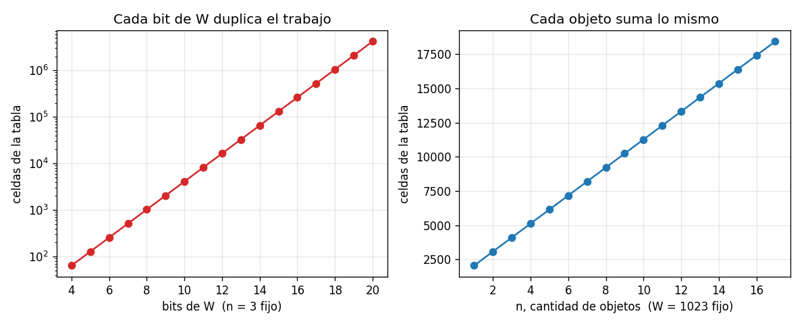
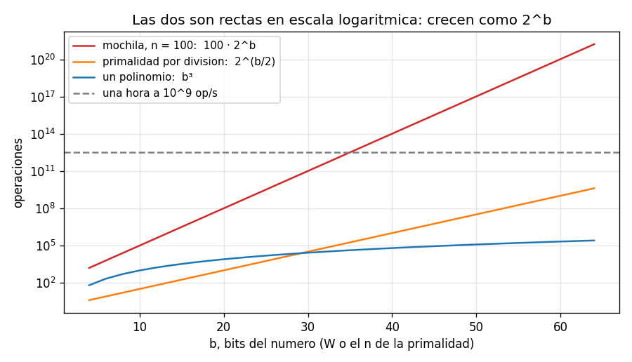

# Ejercicio 11

La mochila entera se resuelve con programación dinámica en $O(nW)$, donde $W$ es la capacidad. Mide el tamaño de la entrada en bits, como en la sección 8 de la conferencia 1. ¿Es polinomial ese algoritmo? ¿En qué se parece a la primalidad por división?

## Idea

El problema: hay $n$ objetos, cada uno con un peso $w_i$ y un valor $v_i$, y una mochila de capacidad $W$. Hay que elegir objetos cuyo peso total no pase de $W$ y cuyo valor total sea el mayor posible. Cada objeto se toma entero o no se toma.

La programación dinámica llena una tabla de $(n+1) \times (W+1)$ celdas, y cada celda cuesta $O(1)$. Por eso cuesta $O(nW)$, y a primera vista parece un algoritmo polinomial: es el producto de dos números de la entrada.

Pero la conferencia 1 (sección 8) dice que un algoritmo se mide en función del tamaño de la entrada, o sea, de cuántos bits ocupa. El número $W$ se escribe con unos $\log_2 W$ bits, no con $W$. Es lo mismo que pasaba con la primalidad: $\sqrt{n}$ divisiones parecía poco, pero $n$ ocupa $b$ bits y $\sqrt{n} = 2^{b/2}$.

Respuesta corta: no es polinomial. Es exponencial en los bits de $W$, y por eso se dice que es pseudopolinomial.

Los casos de prueba están en `ejercicio-11-casos_prueba.py`, el algoritmo en `ejercicio-11-mochila.py` y las gráficas se generan con `ejercicio-11-grafica.py`. Cada prueba tiene `assert`, así que si algo no cuadra el programa da error.

---

## Parte 1: el algoritmo

`best[i][c]` es el mejor valor que se puede conseguir con los primeros $i$ objetos y capacidad $c$. Para el objeto $i$ hay dos opciones:

- no tomarlo: queda `best[i-1][c]`;
- tomarlo, si cabe ($w_i \leq c$): queda `best[i-1][c - w_i] + v_i`.

Se queda con la mejor de las dos.

```python
def knapsack(weights, values, W):
    best = [0] * (W + 1)
    for w, v in zip(weights, values):
        for c in range(W, -1, -1):
            if w <= c and best[c - w] + v > best[c]:
                best[c] = best[c - w] + v
    return best[W]
```

Es la misma tabla de siempre, pero guardando solo la fila anterior: cada objeto recorre las $W + 1$ capacidades. La capacidad se recorre de derecha a izquierda para que `best[c - w]` todavía sea de la fila anterior, y así cada objeto se usa una sola vez. En `ejercicio-11-mochila.py` también está la versión con la tabla entera, que es la que se muestra en la prueba 1.

En total se llenan $(n+1)(W+1)$ celdas, así que el costo es $\Theta(nW)$ operaciones.

### Ejemplo con la tabla

Objetos (peso, valor): (1, 1), (3, 4), (4, 5), (5, 7). Capacidad $W = 7$.

```
                 0   1   2   3   4   5   6   7   <- capacidad c
       ninguno   0   0   0   0   0   0   0   0
    hasta el 1   0   1   1   1   1   1   1   1
    hasta el 2   0   1   1   4   5   5   5   5
    hasta el 3   0   1   1   4   5   6   6   9
    hasta el 4   0   1   1   4   5   7   8   9
```

La respuesta es la esquina de abajo a la derecha: 9, tomando los objetos de peso 3 y 4. El objeto más valioso (peso 5, valor 7) no es parte de la respuesta.

### Casos de prueba

Prueba 1: la tabla de arriba, comprobada con `assert`.

Prueba 2: casos borde.

```
  sin objetos                                   OK
  capacidad 0                                   OK
  un objeto que no cabe                         OK
  un objeto que cabe justo                      OK
  caben todos                                   OK
  dos iguales y solo cabe uno                   OK
  el mas valioso no es parte de la respuesta    OK
```

Prueba 3: contra un oráculo de fuerza bruta, que prueba los $2^n$ subconjuntos de objetos:

```
2000 instancias con n de 0 a 10: 0 fallos
```

---

## Parte 2: el tamaño de la entrada en bits

La entrada son $2n + 1$ números: los $n$ pesos, los $n$ valores y la capacidad $W$. Escritos en binario, el tamaño es

$$b = \sum_{i}(\text{bits de } w_i) + \sum_{i}(\text{bits de } v_i) + \text{bits de } W$$

y los bits de $W$ son $\lfloor \log_2 W \rfloor + 1$, más o menos $\log_2 W$.

$W$ aparece en el tamaño de la entrada como $\log_2 W$, pero en el costo como $W$. Y $W = 2^{\log_2 W}$. Es decir:

- si $W$ tiene 10 bits, puede valer hasta $2^{10} \approx 1000$;
- si $W$ tiene 20 bits, hasta $2^{20} \approx 10^6$;
- si $W$ tiene 64 bits, hasta $2^{64} \approx 1.8 \cdot 10^{19}$.

Agregar 1 bit a $W$ apenas cambia el tamaño de la entrada, pero puede duplicar $W$, y con él las columnas de la tabla.

### Casos de prueba

Prueba 4: se fija $n = 3$ y se hace crecer $W$ de 2 bits en 2 bits:

```
 bits de W          W  bits entrada       celdas    tiempo
         8        255            54        1,024    0.000s
        10      1,023            56        4,096    0.001s
        12      4,095            71       16,384    0.002s
        14     16,383            82       65,536    0.010s
        16     65,535            88      262,144    0.047s
        18    262,143            96    1,048,576    0.182s
        20  1,048,575           103    4,194,304    1.075s
```

Cada 2 bits más de $W$, las celdas se multiplican por 4. El tamaño de la entrada pasa de 54 a 103 bits, que no llega a ser el doble, y las celdas se multiplican por 4096.



A la izquierda, crece $W$ con $n$ fijo: en escala logarítmica es una recta, o sea que las celdas crecen como $2^{\text{bits}}$. A la derecha, crece $n$ con $W$ fijo: cada objeto suma la misma cantidad de celdas. El algoritmo es lineal en $n$ y exponencial en los bits de $W$.

Prueba 5: la misma instancia de la prueba 1, multiplicando todos los pesos y la capacidad por 10, 100 y 1000. Es exactamente el mismo problema, con la misma respuesta, solo que escrito con números más grandes:

```
  factor        W  respuesta  bits entrada     celdas
       1        7          9            22         40
      10       70          9            38        355
     100      700          9            54      3,505
    1000    7,000          9            70     35,005
```

Multiplicar por 10 agrega unos 3.3 bits a cada número, pero multiplica las celdas por 10. El trabajo depende del valor de los números, no de cuánta información tiene la entrada.

---

## Parte 3: demostración de que no es polinomial

Un algoritmo es polinomial si su costo es $O(b^d)$ para alguna constante $d$, donde $b$ es el tamaño de la entrada en bits (conferencia 1, sección 8). Para demostrar que no lo es, alcanza con una familia de entradas en la que el costo crezca más rápido que cualquier polinomio.

Se toma la familia más simple: un solo objeto de peso 1 y valor 1, y capacidad $W = 2^k - 1$ (el mayor número de $k$ bits).

- El tamaño de la entrada es $b = 1 + 1 + k = k + 2$ bits.
- El algoritmo llena $(n + 1)(W + 1) = 2 \cdot 2^k = 2^{k+1}$ celdas, y como $k = b - 2$, eso es $2^{b-1}$ celdas.

Supongamos que el algoritmo fuera polinomial: que existen constantes $c$ y $d$ tales que el costo es a lo sumo $c \cdot b^d$ para toda entrada grande. Entonces, para esta familia,

$$2^{b-1} \leq c \cdot b^d \quad \text{para todo } b \text{ grande}$$

Pero en la conferencia 1 se vio que $b^d \in o(2^b)$: una exponencial le gana a cualquier polinomio. Así que para $b$ suficientemente grande, $2^{b-1} > c \cdot b^d$. Contradicción. El algoritmo no es polinomial. ∎

### ¿Cuándo sí es rápido?

El costo $O(nW)$ es polinomial en el valor de $W$, aunque no en sus bits. Por eso se le llama pseudopolinomial (conferencia 1, sección 8). En la práctica es rápido cuando $W$ es chico:

- si los pesos y la capacidad son números chicos (por ejemplo, $W \leq 1000$), la tabla es pequeña y el algoritmo es muy bueno;
- si $W$ está acotado por un polinomio en $n$, por ejemplo $W \leq n^2$, el costo es $O(n^3)$, que sí es polinomial;
- si $W$ se escribiera en unario (con $W$ símbolos en vez de en binario), la entrada ocuparía $W$ símbolos y el algoritmo sería polinomial en ese tamaño. Esa es justo la definición de pseudopolinomial: polinomial si los números se escriben en unario.

El problema aparece cuando los números son grandes: con una capacidad de 64 bits, la tabla tendría $2^{64}$ columnas.

---

## Parte 4: el parecido con la primalidad por división

La primalidad por división prueba los divisores de 2 hasta $\sqrt{N}$. La mochila llena una tabla con $W + 1$ columnas. Las dos se ven parecidas cuando se miden en bits:

|                         | primalidad por división              | mochila con programación dinámica |
| ----------------------- | ------------------------------------ | --------------------------------- |
| costo                   | $\sqrt{N}$ divisiones                | $(n+1)(W+1)$ celdas               |
| el número que manda     | $N$, el número a probar              | $W$, la capacidad                 |
| bits de ese número      | $b = \log_2 N$                       | $b = \log_2 W$                    |
| costo en función de $b$ | $2^{b/2}$                            | $n \cdot 2^{b}$                   |
| un bit más              | multiplica el trabajo por $\sqrt{2}$ | multiplica el trabajo por 2       |
| polinomial en el valor  | sí                                   | sí                                |
| polinomial en los bits  | no                                   | no                                |

En los dos casos el error es el mismo: medir el costo en función del valor de un número de la entrada, en vez de en función de cuántos bits ocupa. Un ciclo que va hasta el valor de un número cuesta $2^{\text{bits}}$ vueltas.



En escala logarítmica las dos son rectas, que es la forma de una exponencial. El polinomio $b^3$, en cambio, se aplana. La línea gris es lo que se alcanza a hacer en una hora a $10^9$ operaciones por segundo: la mochila con 100 objetos la pasa con unos 35 bits de $W$.

### La diferencia

Para la primalidad hay algoritmos polinomiales en los bits: Miller-Rabin, que es aleatorio, y AKS (2002), que es determinista (conferencia 1). Para la mochila no se conoce ninguno. La mochila es NP-difícil, que es el tema 3 del curso, y encontrar un algoritmo polinomial para ella resolvería P contra NP.

### Casos de prueba

Prueba 6: cuánto tardan los dos a $10^9$ operaciones por segundo, con números de $b$ bits:

```
 bits     primalidad (2^(b/2))    mochila n=100 (100 * 2^b)
   16        2.56e-07 segundos             0.00655 segundos
   32        6.55e-05 segundos                 7.16 minutos
   64            4.29 segundos                5.85e+04 anos
  128                 585 anos                1.08e+24 anos
```

Con 64 bits, la primalidad por división todavía tarda segundos y la mochila tarda decenas de miles de años. La mochila es peor porque su costo es $2^b$ y no $2^{b/2}$, pero las dos son exponenciales.
