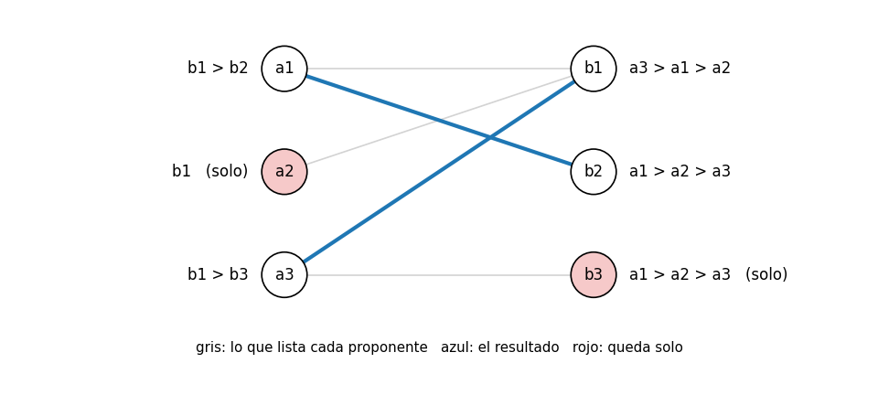
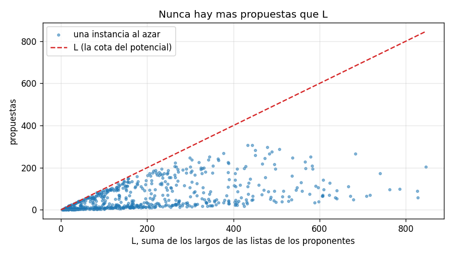
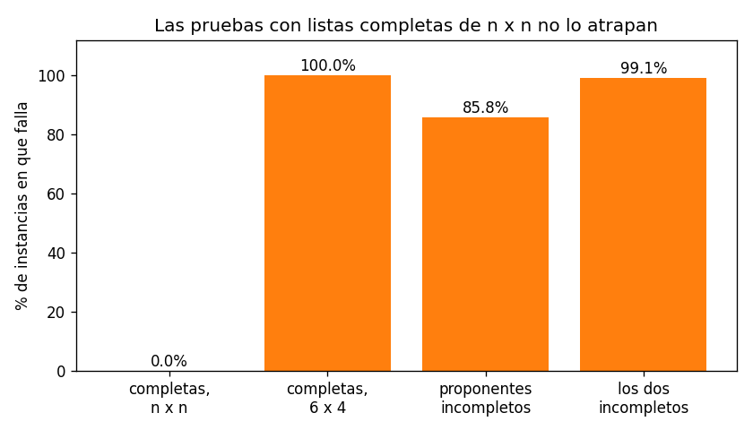

# Ejercicio 12

Gale-Shapley con listas incompletas: cada proponente lista solo a algunos receptores, y prefiere quedarse solo antes que con uno que no listó. Adapta el algoritmo, su potencial y la definición de pareja bloqueante. ¿Sigue siendo estable el resultado? Demuéstralo.

## Idea

En la conferencia 3 cada proponente ordena a todos los receptores y cada receptor ordena a todos los proponentes. Ahora un proponente puede listar solo a algunos, y para él cualquiera de su lista es mejor que quedarse solo, pero quedarse solo es mejor que estar con alguien que no listó.

Eso cambia tres cosas:

- **El resultado ya no es perfecto:** puede haber gente sola. Si un proponente lista solo a `b1` y `b1` prefiere a otro, ese proponente se queda solo. Tampoco hace falta que haya tantos proponentes como receptores.
- **El algoritmo:** un proponente que ya le propuso a todos los de su lista y fue rechazado no tiene a quién más proponerle. Tiene que quedarse solo y dejar de proponer.
- **La pareja bloqueante:** ahora estar solo es una opción más, y la definición tiene que tenerla en cuenta.

Todo lo que sigue funciona igual si los receptores también tienen listas incompletas: un receptor rechaza a cualquier proponente que no esté en su lista. Las pruebas cubren los dos casos.

Los casos de prueba están en `ejercicio-12-casos_prueba.py`, el algoritmo en `ejercicio-12-gale_shapley.py` y las gráficas se generan con `ejercicio-12-grafica.py`. Cada prueba tiene `assert`, así que si algo no cuadra el programa da error.

---

## Parte 1: el algoritmo adaptado

Mientras haya un proponente libre al que todavía le quede alguien en su lista, ese proponente le propone al siguiente de su lista. El receptor:

- lo rechaza si no lo tiene en su lista;
- lo acepta si está libre;
- lo acepta si lo prefiere a su pareja actual, y la pareja anterior queda libre;
- lo rechaza en cualquier otro caso.

Un proponente rechazado vuelve a la fila de libres solo si le queda lista. Si no, se queda solo para siempre.

```python
def gale_shapley(pref_a, pref_b):
    rank = [{a: place for place, a in enumerate(lst)} for lst in pref_b]
    next_place = [0] * len(pref_a)
    partner_of_b = [None] * len(pref_b)
    free = deque(a for a in range(len(pref_a)) if pref_a[a])

    while free:
        a = free.popleft()
        b = pref_a[a][next_place[a]]
        next_place[a] += 1
        current = partner_of_b[b]
        if a not in rank[b]:                   # b no listó a a
            loser = a
        elif current is None:                  # b está libre
            partner_of_b[b] = a
            loser = None
        elif rank[b][a] < rank[b][current]:    # b prefiere a a
            partner_of_b[b] = a
            loser = current
        else:                                  # b prefiere a su pareja
            loser = a
        if loser is not None and next_place[loser] < len(pref_a[loser]):
            free.append(loser)                 # si no le queda lista, se queda solo
    ...
```

Comparado con la conferencia 3 hay dos cambios:

- **Los libres que entran a la fila:** al principio solo entran los que tienen una lista no vacía, y un rechazado solo vuelve si le queda alguien por proponer. Así, `next_place[a]` nunca se sale de la lista de `a`.
- **El receptor revisa su lista:** si el proponente no está en ella, lo rechaza. (Si los receptores tienen listas completas, esta rama no se usa nunca.)

`rank[b]` es un diccionario con el lugar de cada proponente en la lista de `b`, igual que la tabla de rangos de la conferencia 3, para que comparar dos pretendientes cueste $O(1)$. El código completo, que además permite elegir el orden de los libres (cola, pila o al azar), está en `ejercicio-12-gale_shapley.py`.

### Ejemplo con una traza

Tres proponentes y tres receptores:



`a2` solo lista a `b1`, y `b3` está en la lista de `a3` pero solo como segunda opción. La ejecución con la fila en orden:

```
 paso  propone    a  tenia  se queda con
    1       a1   b1      -            a1
    2       a2   b1     a1            a1
    3       a3   b1     a1            a3
    4       a1   b2      -            a1
resultado: a1-b2  a2-solo  a3-b1   (4 propuestas)
```

En el paso 2, `b1` prefiere a `a1`, así que rechaza a `a2`. A `a2` no le queda nadie en su lista, así que se queda solo y no vuelve a la fila. En el paso 3, `b1` cambia a `a1` por `a3`, que le gusta más. `a1` vuelve a la fila y en el paso 4 le propone a `b2`, que lo acepta. `b3` también queda solo, porque nadie le llega a proponer.

### Casos de prueba

Prueba 1: la traza de arriba, comprobada con `assert`.

Prueba 2: casos borde.

```
  nadie lista a nadie: todos solos                OK
  listas completas: igual que la conferencia 3    OK
  todos listan solo a b1: gana su favorito        OK
  4 proponentes y 2 receptores                    OK
  b1 no lista a a1: lo rechaza                    OK
```

El de listas completas usa la instancia de la sección 9 de la conferencia 3, y da el mismo resultado: con listas completas, el algoritmo adaptado es el de siempre.

---

## Parte 2: la nueva definición de pareja bloqueante

Un par $(a, b)$ se acepta mutuamente si $b$ está en la lista de $a$ y $a$ está en la lista de $b$. $M(a)$ es la pareja de $a$ en el emparejamiento $M$, o "solo" si no tiene.

Un emparejamiento $M$ es estable si cumple dos cosas:

- **Nadie está con alguien inaceptable:** si $a$ y $b$ están juntos en $M$, se aceptan mutuamente.
- **No hay parejas bloqueantes.** Un par $(a, b)$ es una pareja bloqueante si:
  1. $a$ y $b$ no están juntos en $M$;
  2. se aceptan mutuamente;
  3. $a$ está solo, o prefiere $b$ a $M(a)$;
  4. $b$ está solo, o prefiere $a$ a $M(b)$.

La diferencia con la conferencia 3 está en los puntos 3 y 4: "estar solo" cuenta como la peor opción posible, peor que cualquiera de la lista. Si $a$ está solo y $b$ también, y se aceptan, los dos ganan juntándose, y eso tiene que contar como bloqueante.

La primera condición también es nueva. Con listas completas todos se aceptaban, pero ahora estar con alguien que no está en tu lista es peor que estar solo.

### Por qué no sirve copiar la definición vieja

Si se copia la definición de la conferencia 3 tal cual ("$a$ prefiere $b$ a su pareja y $b$ prefiere $a$ a la suya"), solo se miran pares donde los dos tienen pareja. Entonces el emparejamiento donde todos están solos no tiene ninguna pareja bloqueante y pasaría por "estable", aunque en el ejemplo `a1` y `b1` se gustan y están solos los dos.

### Casos de prueba

Prueba 8: el emparejamiento con todos solos, en el ejemplo de la parte 1, y un conteo en instancias chicas:

```
emparejamiento con todos solos, en el ejemplo de la prueba 1:
  bloqueantes con la definicion vieja: []
  bloqueantes con la definicion nueva: [('a1', 'b1'), ('a1', 'b2'), ('a2', 'b1'), ('a3', 'b1'), ('a3', 'b3')]
en 200 instancias de 4x4, emparejamientos 'estables' segun la vieja: 5,333
                          y estables de verdad (definicion nueva):   209
```

Con la definición vieja, 25 veces más emparejamientos pasan por "estables", y casi todos son malos.

---

## Parte 3: los invariantes

Son los mismos dos de la conferencia 3, más uno nuevo:

1. **Un receptor, una vez que tiene pareja, no vuelve a quedar solo, y su pareja solo mejora.** Un receptor solo cambia de pareja si llega alguien que está en su lista y que prefiere a la que tiene.
2. **Cada proponente propone en el orden de su lista, sin repetir.** `next_place[a]` solo avanza.
3. **Toda pareja que se forma se acepta mutuamente.** Un proponente solo le propone a los de su lista, y un receptor rechaza a los que no están en la suya.

Los tres se ven leyendo el código, igual que en la conferencia 3.

### Casos de prueba

Prueba 3: los tres invariantes vigilados. En cada propuesta se comprueba con `assert` que el proponente le propone al siguiente de su lista, que la pareja del receptor no empeora y que la pareja que se forma se acepta mutuamente. Son 2000 instancias al azar con tamaños de 1 a 8, con receptores de listas completas e incompletas, y con los tres órdenes de ejecución:

```
invariantes comprobados en 11,333 propuestas, sin fallos
```

---

## Parte 4: el potencial

Sea $L$ la suma de los largos de las listas de los proponentes, o sea, cuántos pares $(a, b)$ hay con $b$ en la lista de $a$. El potencial es

$$\Phi = \text{la cantidad de pares } (a, b) \text{ con } b \text{ en la lista de } a \text{ a los que } a \text{ todavía no le propuso}$$

- Al principio, $\Phi = L$.
- Cada vuelta del `while` es exactamente una propuesta, y nunca se repite, porque `next_place[a]` solo avanza (invariante 2). Así que $\Phi$ baja 1 en cada vuelta.
- $\Phi$ nunca es negativo, porque es una cantidad de pares.

Entonces el algoritmo termina después de a lo sumo $L$ vueltas. Con listas completas de $n \times n$ es $L = n^2$, que es la cota de la conferencia 3.

Lo que cambia respecto a la conferencia 3 es lo que pasa cuando alguien se queda sin lista. Allí se demostraba que eso nunca pasaba, porque con listas completas el resultado es un emparejamiento perfecto. Ahora sí puede pasar, y por eso el algoritmo saca de la fila al que no le queda lista. Así, cada vuelta tiene a alguien a quien proponerle, y el potencial baja de verdad.

### Casos de prueba

Prueba 6: propuestas contra $L$, en instancias al azar de varios tamaños:

```
 tamanos  L promedio  propuestas promedio  propuestas maximo
     5x5        12.5                  5.9           83% de L
   20x20       196.9                 39.0           31% de L
   60x60      1793.3                167.2           14% de L
   60x20       602.0                468.4           87% de L
nunca hay mas propuestas que L
```



Cada punto es una instancia, y ninguna pasa la línea roja. Igual que en la conferencia 3, el caso típico queda muy por debajo de la cota.

---

## Parte 5: ¿sigue siendo estable? Sí

### Teorema

El emparejamiento $M$ que devuelve el algoritmo adaptado es estable, con la definición de la parte 2, para cualquier orden de ejecución.

### Demostración

Hay que ver las dos condiciones de la definición.

Nadie está con alguien inaceptable: es el invariante 3. Toda pareja que se forma se acepta mutuamente, y las parejas del final son parejas que se formaron.

No hay parejas bloqueantes. Por contradicción, supongamos que $(a, b)$ es una pareja bloqueante de $M$: no están juntos, se aceptan mutuamente, $a$ está solo o prefiere $b$ a $M(a)$, y $b$ está solo o prefiere $a$ a $M(b)$.

Primero, $a$ le propuso a $b$ en algún momento. Hay dos casos:

- **Si $a$ terminó solo:** el algoritmo solo deja de lado a un proponente cuando ya le propuso a todos los de su lista. Como $b$ está en la lista de $a$, $a$ le propuso a $b$.
- **Si $a$ terminó con $M(a)$ y prefiere $b$:** $a$ propone en el orden de su lista (invariante 2), y $b$ está antes que $M(a)$. Así que le propuso a $b$ antes de proponerle a $M(a)$.

Segundo, $b$ rechazó a $a$ en algún momento, porque al final no están juntos: o lo rechazó cuando recibió la propuesta, o lo aceptó y después lo cambió por otro. Como $a$ está en la lista de $b$, el rechazo no fue por "no estar en la lista", así que fue porque $b$ tenía, o recibió, a alguien que prefiere a $a$.

Tercero, por el invariante 1, desde ese momento $b$ siempre tiene pareja, y su pareja solo mejora. Así que al final $b$ tiene pareja, y prefiere esa pareja $M(b)$ a $a$.

Eso contradice que $b$ esté solo o que prefiera $a$ a $M(b)$. Entonces no hay parejas bloqueantes, y $M$ es estable. ∎

Es la misma demostración de la sección 8 de la conferencia 3, con un caso nuevo: "$a$ terminó solo". Ese caso funciona porque el algoritmo solo deja solo a un proponente cuando ya agotó su lista.

### Casos de prueba

Prueba 4: estabilidad, contra el oráculo de fuerza bruta que revisa todos los pares. Para cada instancia se corren los tres órdenes de ejecución:

```
  receptores  tamanos  instancias  bloqueantes  inaceptables
   completos      3x3         500            0             0
   completos      5x8         300            0             0
   completos    20x15         100            0             0
 incompletos      3x3         500            0             0
 incompletos      5x8         300            0             0
 incompletos    20x15         100            0             0
```

Ninguna pareja bloqueante y ninguna pareja inaceptable, también con más receptores que proponentes y al revés.

Prueba 5: como en la sección 9 de la conferencia 3, en instancias chicas se enumeran todos los emparejamientos estables y se comparan con el resultado:

```
mismo resultado con las cuatro ejecuciones: 200 de 200
cada proponente con lo mejor que consigue en un emparejamiento estable: 200 de 200
```

Esto no se pide en el ejercicio y no se demuestra aquí, pero el experimento sugiere que la optimalidad para los proponentes de la conferencia 3 también se mantiene con listas incompletas.

---

## Parte 6: el costo

Hay a lo sumo $L$ propuestas, y cada una cuesta $O(1)$: leer el siguiente de la lista y consultar `rank[b]`, que es un diccionario. Armar `rank` cuesta lo que suman las listas de los receptores. Así que el costo total es $O(L + L_b)$, donde $L_b$ es la suma de los largos de las listas de los receptores: es lineal en el tamaño de la entrada.

Con listas completas de $n \times n$ queda $O(n^2)$, como en la conferencia 3. Con listas cortas es mucho menos: si cada proponente lista 3 receptores, son a lo sumo $3n$ propuestas.

---

## Parte 7: copiar el algoritmo sin adaptarlo

Una variante es usar el código de la conferencia 3 tal cual, sin revisar si al proponente le queda lista:

```python
while free:
    a = free.popleft()
    b = pref_a[a][next_place[a]]      # falla si la lista de a se acabó
    ...
```

La demostración dice dónde falla. En la conferencia 3 se demostraba aparte que ningún proponente se quedaba sin lista, usando que el resultado era un emparejamiento perfecto. Esa demostración usa dos cosas: que las listas son completas y que hay tantos proponentes como receptores. Si falla cualquiera de las dos, algún proponente puede agotar su lista, y el código pide un elemento que no existe.

### Casos de prueba

Prueba 7: la versión sin adaptar, contra el algoritmo bien hecho:

```
                   listas   fallos
         completas, n x n     0.0%
         completas, 6 x 4   100.0%
  proponentes incompletos    85.8%
      los dos incompletos    99.1%
```



Con listas completas y la misma cantidad de cada lado, que es como se prueba en la conferencia 3, no falla nunca. Con más proponentes que receptores falla siempre, porque alguno tiene que quedarse solo. Con listas incompletas falla casi siempre.

Las pruebas más habituales, copiadas de las de la conferencia, no lo encuentran. Lo que dice qué hay que probar es la hipótesis que usaba la demostración vieja: listas completas y $n \times n$.
