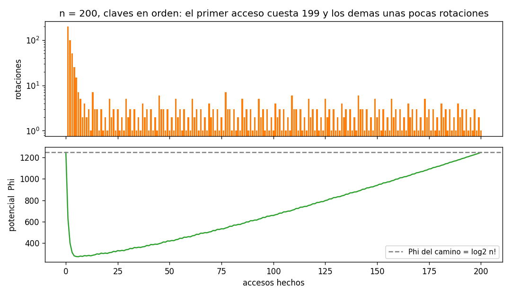
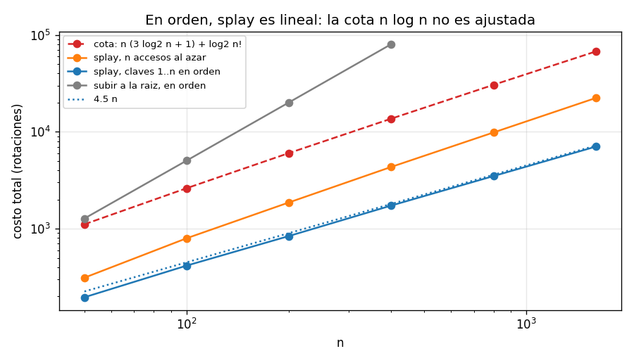

# Ejercicio 13

En un splay tree que empieza como un camino de $n$ nodos se accede a las claves $1, \dots, n$ en orden. Acota el costo total con el lema de acceso y la cuenta de la sección 5 de la conferencia 4, y compáralo con lo que mide la sección 6. ¿Es ajustada la cota?

## Idea

El árbol inicial es el peor posible: un camino con $n$ en la raíz y cada clave como hija izquierda de la siguiente. La clave 1 está en el fondo, a profundidad $n - 1$. Después se accede a $1, 2, \dots, n$ en orden, y cada acceso hace splay de la clave hasta la raíz.

El ejercicio pide dos números y compararlos:

- **La cota:** lo que dice el lema de acceso de la conferencia 4 (sección 5), sumado sobre los $n$ accesos.
- **Lo que pasa de verdad:** la conferencia 4 (sección 6) mide unas 4.2 rotaciones por acceso con esta misma secuencia.

La cota resulta ser $\Theta(n \log n)$, y el costo real es $\Theta(n)$. La cota no es ajustada, y la parte 4 explica dónde se pierde.

Los casos de prueba están en `ejercicio-13-casos_prueba.py`, el splay tree en `ejercicio-13-splay.py` y las gráficas se generan con `ejercicio-13-grafica.py`. Cada prueba tiene `assert`, así que si algo no cuadra el programa da error.

---

## Parte 1: el splay tree

Es el código de la conferencia 4, con los nombres en inglés: `rotate` sube un nodo un nivel, y `splay` lo sube hasta la raíz con pasos zig, zig-zig (rotando primero el padre) y zig-zag. Un acceso busca la clave y hace splay. Su costo es la cantidad de rotaciones, o 1 si la clave ya estaba en la raíz.

### Ejemplo

Con $n = 16$, el costo de cada acceso:

```
  claves:  1  2  3  4  5  6  7  8  9 10 11 12 13 14 15 16
  costos: 15  8  5  2  4  2  3  1  3  1  2  1  3  1  2  1
  total: 54
```

El primer acceso cuesta 15, porque la clave 1 está en el fondo del camino. El splay deja la profundidad de los nodos del camino más o menos a la mitad, así que el segundo acceso cuesta 8, el tercero 5, y desde ahí los accesos cuestan unas pocas rotaciones.

### Casos de prueba

Prueba 1: la tabla de arriba.

Prueba 2: después de cada acceso, el árbol sigue siendo de búsqueda y la clave accedida está en la raíz. En 200 árboles con accesos al azar:

```
17,382 accesos al azar, siempre bien
```

---

## Parte 2: la cota con el lema de acceso

### Lo que dice la conferencia 4

El potencial es $\Phi = \sum_x r(x)$, donde $r(x) = \log_2 s(x)$ y $s(x)$ es la cantidad de nodos del subárbol de $x$.

**Lema de acceso.** El costo amortizado de hacer splay de $x$ en un árbol con raíz $t$ es a lo sumo $3(r(t) - r(x)) + 1$.

Como $r(t) = \log_2 n$ y $r(x) \geq 0$, cada acceso cuesta a lo sumo $3 \log_2 n + 1$ amortizado. Sumando los $m$ accesos, con la cuenta de la sección 5:

$$\sum c_i = \sum \hat{c}_i - \Phi_m + \Phi_0 \leq m(3 \log_2 n + 1) + \Phi_0$$

usando que $\Phi_m \geq 0$.

### El potencial inicial

El árbol empieza como un camino. El nodo de la clave $k$ tiene en su subárbol a $1, 2, \dots, k$, o sea $s = k$. Entonces

$$\Phi_0 = \log_2 1 + \log_2 2 + \dots + \log_2 n = \log_2 n!$$

que es a lo sumo $n \log_2 n$.

### La cota

Con $m = n$ accesos:

$$\text{costo total} \leq n(3 \log_2 n + 1) + \log_2 n! \leq 4 n \log_2 n + n$$

La cota es $O(n \log n)$.

### Casos de prueba

Prueba 3: el lema de acceso vigilado. En cada acceso se calcula el potencial antes y después y se comprueba con `assert` que el costo amortizado no pasa de $3(r(t) - r(x)) + 1$, con las claves en orden y al azar:

```
lema comprobado en 1,380 accesos; el costo amortizado nunca pasa la cota (la mayor diferencia es 0.00)
```

La mayor diferencia es 0: en algunos accesos el costo amortizado es exactamente la cota (por ejemplo, cuando la clave ya está en la raíz), pero nunca la pasa.

---

## Parte 3: lo que pasa de verdad

### Casos de prueba

Prueba 4: el costo real de acceder a $1, \dots, n$ en orden, contra la cota:

```
     n  costo real  real / n       cota  cota / real  Phi_0 = log2 n!
   100         416      4.16      2,618          6.3              525
   200         840      4.20      6,032          7.2            1,245
   400       1,732      4.33     13,659          7.9            2,886
   800       3,490      4.36     30,512          8.7            6,567
 1,600       7,024      4.39     67,419          9.6           14,729
```

El costo real por acceso se mantiene alrededor de 4.2 a 4.4, igual que lo que mide la sección 6 de la conferencia 4. La cota, en cambio, crece como $\log n$: con $n = 1600$ es casi 10 veces el costo real, y la proporción sigue creciendo.

Prueba 5: tres rondas seguidas, como en la sección 6 de la conferencia 4:

```
     n  costo por acceso  cota por acceso
   100              4.16            22.68
   200              4.20            26.01
   400              4.33            29.34
   800              4.36            32.67
```

Son los mismos 4.2 a 4.4 de la tabla de la conferencia (4.2, 4.2, 4.3, 4.4).



Arriba, el costo de cada acceso con $n = 200$ (en escala logarítmica): el primero cuesta 199, los siguientes bajan rápido, y después todos cuestan entre 1 y 7. Abajo, el potencial: el primer acceso lo baja de $\log_2 200! \approx 1245$ a menos de 300, porque deja el árbol mucho más balanceado. Después sube despacio, y al final vuelve a valer $\log_2 n!$.

---

## Parte 4: ¿es ajustada la cota? No

La cota es $\Theta(n \log n)$ y el costo real es $\Theta(n)$, así que la cota no es ajustada: se pasa por un factor que crece como $\log n$.

### Dónde se pierde

La gráfica del potencial muestra algo importante: después de acceder a la clave $n$, el árbol vuelve a ser un camino (con $n$ en la raíz y todo lo demás a la izquierda), así que $\Phi_{final} = \Phi_0$. Entonces la cuenta de la sección 5 queda exacta:

$$\sum c_i = \sum \hat{c}_i - \Phi_m + \Phi_0 = \sum \hat{c}_i$$

El costo real total es exactamente la suma de los costos amortizados. Lo que se pierde está en el lema de acceso: el lema permite que cada acceso cueste hasta $3(\log_2 n - r(x)) + 1$ amortizado, pero en esta secuencia los costos amortizados son mucho menores.

Además, el problema no es solo el paso $r(x) \geq 0$. Aunque se use el rango verdadero del nodo en cada acceso, la suma de las cotas del lema sigue siendo $\Theta(n \log n)$, porque el nodo accedido suele tener un subárbol chico (en el ejemplo de la prueba, los rangos son 1, 0, 3, 0, 2.58, ...).

### Casos de prueba

Prueba 4b: el costo real, la suma de las cotas del lema con los rangos verdaderos, y el potencial al principio y al final:

```
       n  costo real  suma de cotas del lema    Phi_0  Phi_final
     100         416                   1,442      525        525
     400       1,732                   7,211    2,886      2,886
   1,600       7,024                  34,835   14,729     14,729
```

El potencial termina donde empezó, así que el costo real es igual a la suma de los costos amortizados (también comprobado con `assert`). La suma de las cotas del lema, aunque use los rangos verdaderos, crece como $n \log n$: es la cota del lema la que no es ajustada para esta secuencia.

### El resultado verdadero

Que acceder a todas las claves en orden cueste $O(n)$ es un teorema aparte, el teorema de acceso secuencial (Tarjan, 1985). Su demostración necesita un argumento más fino que el lema de acceso, y no se hace aquí.

### La cota sí es ajustada para otras secuencias

El lema de acceso no está mal: hay secuencias donde el costo sí es $\Theta(n \log n)$. Por ejemplo, con accesos al azar el costo por acceso crece como $\log n$.

Prueba 6: costo por acceso con las claves en orden y al azar:

```
     n  en orden: real / n  al azar: real / n  log2 n
   100                4.16               7.01     6.6
   400                4.33               9.80     8.6
  1600                4.39              12.75    10.6
```

Con accesos al azar, el costo por acceso crece un poco más que $\log_2 n$, y la cota de $3 \log_2 n + 1$ por acceso describe bien su crecimiento. Lo que la cota no ve es que el acceso en orden es más barato.

### Comparación con subir a la raíz

Prueba 7: la misma secuencia con la heurística de subir a la raíz con rotaciones simples (la segunda ronda, cuando ya se ve el comportamiento estable):

```
     n     splay  subir a la raiz   n^2 / 2
   100       416            5,049     5,000
   200       840           20,099    20,000
   400     1,732           80,199    80,000
```

Subir a la raíz cuesta unas $n^2/2$ rotaciones por ronda, como dice la sección 6 de la conferencia 4.



En escala logarítmica: splay en orden (azul) sigue la recta $4.5 n$. La cota (roja) y los accesos al azar (naranja) crecen como $n \log n$, y subir a la raíz (gris) como $n^2$.
