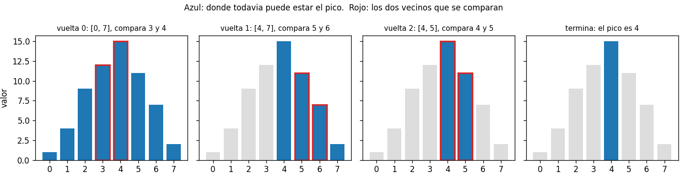
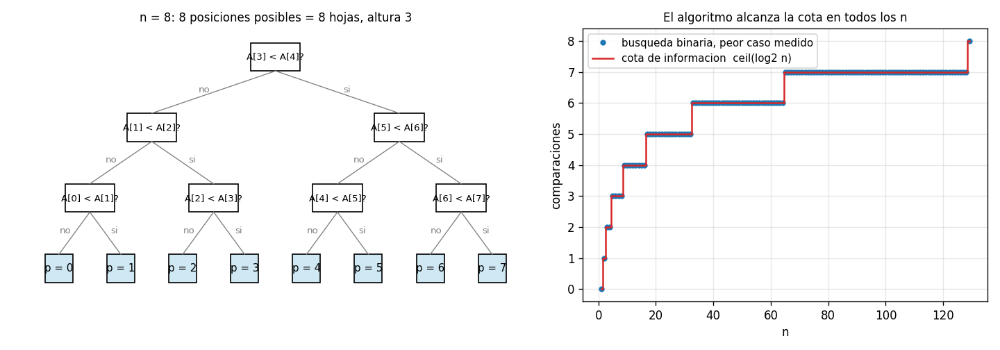

# Ejercicio 14

Escoge un problema que no hayamos visto, recorre el ciclo completo de la conferencia 2 sobre él y consigue que el algoritmo y la cota mínima coincidan. Es el formato de la pregunta larga del examen final.

## Idea

El problema elegido es encontrar el pico de un arreglo unimodal: un arreglo que primero sube y después baja, como la altura a lo largo de un camino que cruza una montaña. No aparece en las conferencias.

La conferencia 2 organiza el trabajo en cinco preguntas, y este ejercicio las recorre en orden:

1. **¿Cuál es el problema?** Enunciarlo con precisión.
2. **¿Qué algoritmo lo resuelve?**
3. **¿Es correcto?** Con un invariante y un potencial (conferencia 3).
4. **¿Cuánto cuesta?** El peor caso exacto.
5. **¿Se puede hacer mejor?** Una cota mínima (conferencia 5).

El resultado es que la búsqueda binaria sobre las pendientes hace exactamente $\lceil \log_2 n \rceil$ comparaciones en el peor caso, y la cota de información es exactamente $\lceil \log_2 n \rceil$. Coinciden sin ninguna diferencia, ni siquiera en la constante.

Los casos de prueba están en `ejercicio-14-casos_prueba.py`, los algoritmos en `ejercicio-14-pico.py` y las gráficas se generan con `ejercicio-14-grafica.py`. Cada prueba tiene `assert`, así que si algo no cuadra el programa da error.

---

## Parte 1: el problema

**Pico de un arreglo unimodal.** Dado un arreglo $A[0..n-1]$ con $n \geq 1$ que es estrictamente creciente hasta una posición $p$ y estrictamente decreciente desde ahí,

$$A[0] < A[1] < \dots < A[p] > A[p+1] > \dots > A[n-1]$$

devolver $p$, la posición del máximo.

Tres precisiones, como pide la conferencia 2 (sección 2):

- **El pico puede estar en un extremo:** si $p = n - 1$ el arreglo solo sube, y si $p = 0$ solo baja.
- **Las desigualdades son estrictas:** no hay dos vecinos iguales. Esto es una precondición, y la parte 6 muestra qué pasa si no se cumple.
- **El modelo es el de comparaciones:** el algoritmo solo puede comparar elementos del arreglo entre sí, y su costo es la cantidad de comparaciones (conferencia 5, sección 1).

Ejemplo: en `A = [1, 4, 9, 12, 15, 11, 7, 2]` el pico está en la posición 4, con valor 15.

---

## Parte 2: el algoritmo

### Fuerza bruta

Recorrer el arreglo y quedarse con el mayor. Hace $n - 1$ comparaciones. Sirve para cualquier arreglo, unimodal o no, y por eso se usa como oráculo en las pruebas.

### Búsqueda binaria sobre las pendientes

La fuerza bruta no aprovecha que el arreglo es unimodal. Comparando dos vecinos $A[m]$ y $A[m+1]$ se sabe de qué lado de la montaña se está:

- **si $A[m] < A[m+1]$:** se está subiendo, así que el pico está a la derecha de $m$;
- **si $A[m] > A[m+1]$:** se está bajando, así que el pico es $m$ o está a su izquierda.

Cada comparación descarta la mitad del rango.

```python
def peak_binary(A):
    lo, hi = 0, len(A) - 1             # invariante: el pico está en [lo, hi]
    while lo < hi:
        m = (lo + hi) // 2
        if A[m] < A[m + 1]:            # subiendo: el pico está a la derecha de m
            lo = m + 1
        else:                          # bajando: el pico es m o está a la izquierda
            hi = m
    return lo
```

### Ejemplo con una traza

```
A = [1, 4, 9, 12, 15, 11, 7, 2]
  lo   hi    m   A[m]  A[m+1]   decision
   0    7    3     12      15   sube: el pico esta a la derecha
   4    7    5     11       7   baja: el pico es m o esta a la izquierda
   4    5    4     15      11   baja: el pico es m o esta a la izquierda
pico en la posicion 4, valor 15
```



En cada vuelta, el azul es el rango donde todavía puede estar el pico, y los dos bordes rojos son los vecinos que se comparan.

### Casos de prueba

Prueba 1: la traza de arriba, comprobada con `assert`.

Prueba 2: casos borde.

```
  un solo elemento                          OK
  dos, creciente                            OK
  dos, decreciente                          OK
  todo creciente: el pico es el ultimo      OK
  todo decreciente: el pico es el primero   OK
  negativos                                 OK
```

---

## Parte 3: la correctitud

### El invariante

**Invariante:** antes de cada vuelta, el pico $p$ está en $[lo, hi]$.

#### Inicialización

Al principio $lo = 0$ y $hi = n - 1$: el rango es el arreglo entero. ✔

#### Mantenimiento

Sea $m = \lfloor (lo + hi)/2 \rfloor$. Como $lo < hi$, se cumple $m < hi$, así que $m + 1$ también está en el rango. Hay dos casos:

1. **$A[m] < A[m+1]$:** si el pico estuviera en una posición $\leq m$, desde ahí el arreglo bajaría, y $A[m] > A[m+1]$. Como no es así, el pico está en una posición $\geq m + 1$. El rango nuevo es $[m+1, hi]$. ✔
2. **$A[m] > A[m+1]$:** si el pico estuviera en una posición $\geq m + 1$, hasta ahí el arreglo subiría, y $A[m] < A[m+1]$. Como no es así, el pico está en una posición $\leq m$. El rango nuevo es $[lo, m]$. ✔

No hay un tercer caso, porque los vecinos nunca son iguales (la precondición).

#### Conclusión

El ciclo termina cuando $lo = hi$. Por el invariante, el pico está en $[lo, lo]$, así que el pico es $lo$, que es lo que devuelve. ✔

### El potencial

$$\Phi = hi - lo$$

- **Nunca es negativo:** por el invariante, el rango no está vacío.
- **Baja en cada vuelta:** el rango nuevo es $[m+1, hi]$ o $[lo, m]$, y los dos son más chicos que $[lo, hi]$ porque $lo \leq m < hi$.
- **Cuando llega a 0, el ciclo termina:** la condición del `while` es $\Phi > 0$.

Así que el algoritmo termina, y es correcto. ∎

### Casos de prueba

Prueba 3: el invariante vigilado. Antes de cada vuelta se comprueba con `assert` que el pico está en $[lo, hi]$:

```
invariante comprobado en 16,781 vueltas, sin fallos
```

Prueba 4: contra el oráculo de fuerza bruta, en arreglos unimodales al azar:

```
5000 arreglos unimodales al azar: 0 fallos
```

---

## Parte 4: el costo

El rango $[lo, hi]$ tiene $s = hi - lo + 1$ elementos. Con $m$ en el medio, la mitad de la izquierda $[lo, m]$ tiene $\lceil s/2 \rceil$ elementos y la de la derecha $[m+1, hi]$ tiene $\lfloor s/2 \rfloor$. En el peor caso el rango pasa de $s$ a $\lceil s/2 \rceil$.

Empezando con $s = n$, después de $t$ vueltas el rango tiene a lo sumo $\lceil n / 2^t \rceil$ elementos. El ciclo para cuando queda uno, y eso pasa cuando $2^t \geq n$, o sea, después de $\lceil \log_2 n \rceil$ vueltas. Cada vuelta hace una comparación.

El algoritmo hace a lo sumo $\lceil \log_2 n \rceil$ comparaciones. La memoria es $O(1)$.

### Casos de prueba

Prueba 5: el peor caso exacto, probando el pico en todas las posiciones posibles:

```
     n  peor caso  cota ceil(log2 n)  fuerza bruta n - 1
     1          0                  0                   0
     2          1                  1                   1
     3          2                  2                   2
     8          3                  3                   7
     9          4                  4                   8
   100          7                  7                  99
  1000         10                 10                 999
  1024         10                 10                1023
  1025         11                 11                1024
```

El peor caso es exactamente $\lceil \log_2 n \rceil$ en todos los casos.

---

## Parte 5: la cota mínima

### Teorema

Todo algoritmo de comparaciones que encuentra el pico de un arreglo unimodal de largo $n$ hace, en el peor caso, al menos $\lceil \log_2 n \rceil$ comparaciones.

### Demostración

Es un argumento de información (conferencia 5, sección 3), en tres pasos.

**Paso 1: cualquier posición puede ser el pico.** Para cada $p$ entre 0 y $n - 1$ hay un arreglo unimodal con el pico en $p$ y todos los valores distintos. Por ejemplo, $A[i] = i$ para $i \leq p$, y $A[i] = p - (i - p) + 0.5$ para $i > p$ (los de la derecha son medios enteros, así que no coinciden con ninguno de la izquierda).

**Paso 2: cada posición necesita su propia hoja.** El algoritmo es un árbol de decisión. Como todos los valores son distintos, cada comparación tiene dos respuestas, y el árbol es binario. La salida depende solo de la hoja: dos entradas que reciben las mismas respuestas llegan a la misma hoja y reciben la misma salida. Si dos entradas tienen el pico en posiciones distintas, necesitan salidas distintas, así que no pueden compartir hoja. Con el paso 1, el árbol tiene al menos $n$ hojas.

**Paso 3: la altura.** Un árbol binario de altura $h$ tiene a lo sumo $2^h$ hojas (conferencia 5, lema 1). Entonces $2^h \geq n$, y como $h$ es entero, $h \geq \lceil \log_2 n \rceil$. ∎

### El algoritmo y la cota coinciden

| | comparaciones en el peor caso |
| --- | --- |
| búsqueda binaria sobre las pendientes | $\lceil \log_2 n \rceil$ |
| cota mínima de información | $\lceil \log_2 n \rceil$ |
| fuerza bruta | $n - 1$ |

Son exactamente iguales, para todo $n$. La búsqueda binaria es óptima en el modelo de comparaciones, y no se puede ganar ni una comparación.



A la izquierda, el árbol de decisión de la búsqueda binaria con $n = 8$, obtenido corriéndola con el pico en cada posición: 8 hojas, una por posición, y altura 3. A la derecha, el peor caso medido para $n$ de 1 a 129 cae siempre sobre la escalera de la cota.

### Casos de prueba

Prueba 6: con $n = 8$, se corre el algoritmo con el pico en cada posición y se anotan las respuestas que recibe (`<` si sube, `>` si baja):

```
  pico en 0: respuestas >>>
  pico en 1: respuestas >><
  pico en 2: respuestas ><>
  pico en 3: respuestas ><<
  pico en 4: respuestas <>>
  pico en 5: respuestas <><
  pico en 6: respuestas <<>
  pico en 7: respuestas <<<
8 posiciones, 8 caminos distintos, largo maximo 3 = ceil(log2 8)
```

Cada posición recibe una secuencia de respuestas distinta, que es el paso 2 de la demostración. Además, las 8 secuencias son todas las combinaciones posibles de 3 respuestas: el árbol está lleno, y no sobra ninguna hoja.

---

## Parte 6: lo que pasa si se cambia algo

### Un error fácil: `hi = m - 1`

Por costumbre de la búsqueda binaria común, es fácil escribir `hi = m - 1` en el segundo caso. Pero cuando $A[m] > A[m+1]$, el pico puede ser el propio $m$, y esa versión lo descarta. El invariante lo dice: en el mantenimiento, el caso 2 solo garantiza que el pico está en $[lo, m]$, no en $[lo, m-1]$.

Prueba 7: la versión con `hi = m - 1`, con el pico en distintas posiciones:

```
                        pico  casos   fallos
     en una posicion al azar   3000    37.8%
       en el primer elemento   3000     0.0%
       en el ultimo elemento   3000     0.0%
contraejemplo: A = [1, 5, 3] -> 0  (el pico esta en 1)
```

Si las pruebas solo usan arreglos que suben o que bajan todo el tiempo (el pico en un extremo), la versión con el error las pasa todas. Con el pico en el medio falla en más de un tercio de los casos.

### Si se permiten vecinos iguales

La precondición dice que las desigualdades son estrictas. Si se permiten valores iguales, la búsqueda binaria deja de funcionar, porque ante $A[m] = A[m+1]$ no se sabe de qué lado está el pico. Por ejemplo, en `[5, 5, 5, 5, 9, 5]` toda la parte de la izquierda es plana, y comparar dos vecinos iguales no dice nada.

Prueba 8: arreglos planos con un solo pico:

```
3000 arreglos 'planos con un pico': la busqueda binaria falla en 72.7%
contraejemplo: A = [5, 5, 5, 5, 9, 5] -> posicion 0 valor 5
```

En esa versión del problema, ningún algoritmo puede ser logarítmico. Un adversario como el de la conferencia 5 (sección 5) contesta "iguales" a todas las comparaciones, como si el arreglo fuera plano. Mientras quede un elemento que no se comparó con nada, el pico puede ser ese, y el algoritmo no puede responder. Cada comparación toca dos elementos, y hay que tocar al menos $n - 1$, así que hacen falta al menos $\lceil (n-1)/2 \rceil$ comparaciones: $\Omega(n)$. Es otra vez la regla de las conferencias 2 y 5: una cota mínima vale para un problema y un modelo precisos, y cambiar una precondición puede cambiar la respuesta.
